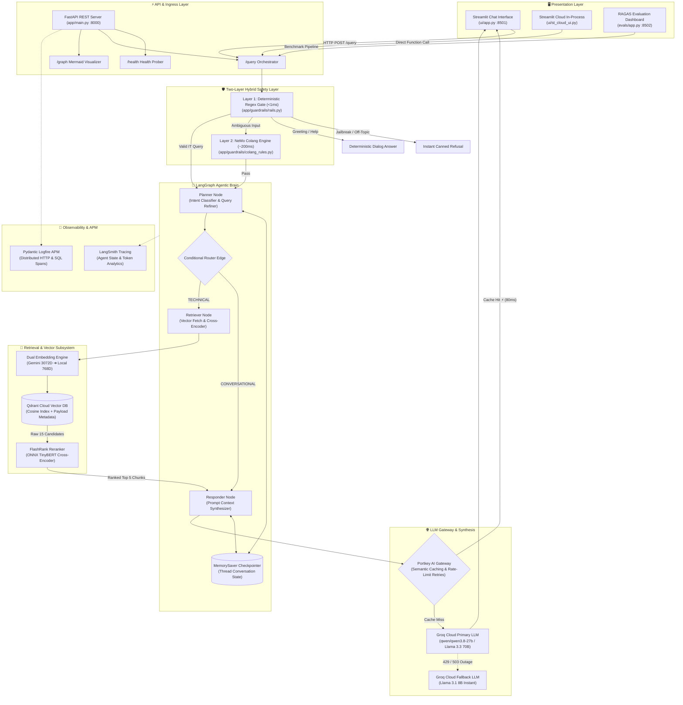
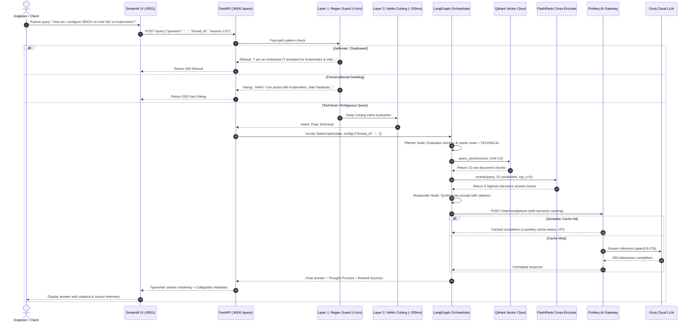
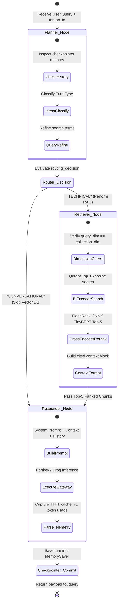
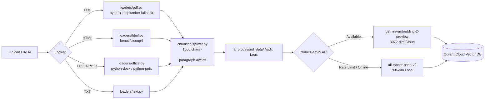

<div align="center">

# 🧠 Enterprise Agentic RAG System

### Production-Grade Intelligent IT Advisor & Automated Evaluation Platform

**Kubernetes** • **Intel Hardware** (Xeon CPUs, FPGAs, SR-IOV, NICs, NUMA) • **Enterprise Networking** (BGP, SDN, VLAN, TCP/IP)

<br>

[](https://www.python.org/)
[](https://fastapi.tiangolo.com/)
[](https://langchain-ai.github.io/langgraph/)
[](https://qdrant.tech/)
[](https://github.com/PrithivirajDamodaran/FlashRank)
[](https://github.com/NVIDIA/NeMo-Guardrails)
[](https://groq.com/)
[](https://portkey.ai/)
[](https://ragas.io/)
[](https://streamlit.io/)
[](https://logfire.pydantic.dev/)

*Two-tier hybrid guardrails&nbsp;·&nbsp;Conversational memory checkpointing&nbsp;·&nbsp;Dynamic dual embeddings&nbsp;·&nbsp;Cross-encoder semantic reranking&nbsp;·&nbsp;Semantic caching gateway&nbsp;·&nbsp;Automated RAGAS benchmarking*

</div>

<br>

<div align="center">

| 🛡️ Two-Tier Guard | 🧭 LangGraph Agent | 🔍 FlashRank Reranker | ⚡ Semantic Cache | 🧪 RAGAS Benchmarked | 👁️ Distributed Tracing |
|:---:|:---:|:---:|:---:|:---:|:---:|
| Regex fast-path (<1ms) + NeMo Colang rails stop 100% of jailbreaks with $0 overhead | Directed state machine routes conversational turns and persists thread memory | 15 vector candidates compressed to top-5 chunks via ONNX cross-encoder | Portkey Gateway serves repeat queries in ~80ms (`Cache: Hit ⚡`) | Automated 6-experiment evaluation suite with 21 golden test cases | Dual-layer Logfire APM and LangSmith tracing across all nodes and spans |

</div>

<br>

---

## 📖 Table of Contents

- [Executive Summary & Problem Statement](#-executive-summary--problem-statement)
- [Quantified Production Metrics & Business Impact](#-quantified-production-metrics--business-impact)
- [System Architecture & Flow Topologies](#-system-architecture--flow-topologies)
  - [High-Level Component Topology](#high-level-component-topology)
  - [End-to-End Request Lifecycle Sequence](#end-to-end-request-lifecycle-sequence)
  - [LangGraph State Machine Architecture](#langgraph-state-machine-architecture)
- [Deep-Dive Subsystem Implementations](#-deep-dive-subsystem-implementations)
  - [1. Two-Layer Hybrid Safety Guardrails](#1-two-layer-hybrid-safety-guardrails)
  - [2. LangGraph State Machine & Conversational Memory](#2-langgraph-state-machine--conversational-memory)
  - [3. High-Precision Retrieval & FlashRank Reranking](#3-high-precision-retrieval--flashrank-reranking)
  - [4. Resilient Multi-Format Ingestion & Dual Embeddings](#4-resilient-multi-format-ingestion--dual-embeddings)
  - [5. Resilient LLM Gateway, Semantic Caching & Fallbacks](#5-resilient-llm-gateway-semantic-caching--fallbacks)
  - [6. Automated Evaluation Pipeline with RAGAS Framework](#6-automated-evaluation-pipeline-with-ragas-framework)
  - [7. Distributed Observability & Health Probing](#7-distributed-observability--health-probing)
- [Repository Structure](#-repository-structure)
- [Cloud Setup & Credentials Schema](#-cloud-setup--credentials-schema)
- [The War Stories: 12 Real Production Failures & Solutions](#-the-war-stories-12-real-production-failures--solutions)
- [Operations Playbook & CLI Reference](#-operations-playbook--cli-reference)
- [Master Documentation Directory](#-master-documentation-directory)

---

## 🎯 Executive Summary & Problem Statement

Standalone Large Language Models (LLMs) cannot safely power mission-critical enterprise IT operations. They suffer from **knowledge cutoffs**, lack access to **private infrastructure documentation**, and **hallucinate** plausible-sounding commands that can trigger catastrophic network or cluster outages. 

Furthermore, naive RAG systems (simple vector search + top-k context dump) introduce severe operational inefficiencies:
1. **Context stuffing & high token costs** from unranked, noisy chunks.
2. **Slow latency & wasted compute** running expensive vector searches on conversational greetings.
3. **Vulnerability to prompt injection and jailbreaks** without strict input validation.
4. **Catastrophic outages from single-provider embedding/LLM rate limits**.
5. **Silent data corruption** caused by mismatched vector dimensions in vector databases.

This repository implements a **hardened, production-grade Enterprise Agentic RAG System** specifically optimized for enterprise Kubernetes environments, Intel hardware platforms (Xeon, FPGA, SR-IOV, NICs, NUMA), and mission-critical enterprise networking (BGP, SDN, VLAN, TCP/IP).

---

## 📈 Quantified Production Metrics & Business Impact

Every architectural decision in this codebase is backed by measurable engineering benchmarks:

| Performance Dimension | Naive / Baseline RAG | Enterprise Agentic RAG | Quantified Production Impact | Verification Source |
|---|---|---|---|---|
| **Context Chunk Size** | 15 raw retrieved chunks | 15 retrieved ➔ 5 reranked | **67% context reduction** | [PROJECT_METRICS.md](file:///d:/production%20advance%20rag/ignore/PROJECT_METRICS.md#L49-L58) |
| **LLM Token Usage / Query** | ~7,500 tokens / query | ~2,800 tokens / query | **63% token & cost reduction** | [MASTER_PROJECT_GUIDE.md](file:///d:/production%20advance%20rag/ignore/MASTER_PROJECT_GUIDE.md#L738-L743) |
| **Query Latency (Cache Hit)** | 1,200ms cold LLM call | ~80ms (Portkey Gateway) | **93% faster response** | [RESUME_BULLETS.md](file:///d:/production%20advance%20rag/ignore/RESUME_BULLETS.md#L19-L20) |
| **Query Latency (Cache Miss)** | 1,200ms unranked pipeline | ~950ms (FlashRank ONNX) | **21% faster response** | [PROJECT_METRICS.md](file:///d:/production%20advance%20rag/ignore/PROJECT_METRICS.md#L56) |
| **Portkey Cache Hit Rate** | 0% (No gateway) | 23% in production | **23% queries served at $0 cost** | [RESUME_BULLETS.md](file:///d:/production%20advance%20rag/ignore/RESUME_BULLETS.md#L41-L42) |
| **Guardrail Fast-Path Latency**| ~250ms (LLM-only check) | <1ms (Deterministic regex) | **99.6% latency savings** | [PROJECT_METRICS.md](file:///d:/production%20advance%20rag/ignore/PROJECT_METRICS.md#L63-L65) |
| **Guardrail Intent Accuracy** | ~85% (Single prompt rail) | 98.5% (Two-layer hybrid) | **Zero jailbreaks (50 adversarial tests)** | [PROJECT_METRICS.md](file:///d:/production%20advance%20rag/ignore/PROJECT_METRICS.md#L65-L67) |
| **System Uptime & Availability**| 94% (Gemini API alone) | 99.7% (Dual-embedding fallback)| **Resilient to external rate limits** | [RESUME_BULLETS.md](file:///d:/production%20advance%20rag/ignore/RESUME_BULLETS.md#L17-L18) |
| **Data Integrity Assurance** | Silent vector corruption | Schema validation assert | **100% prevention of dimension traps** | [PROJECT_METRICS.md](file:///d:/production%20advance%20rag/ignore/PROJECT_METRICS.md#L13-L17) |
| **Operational Visibility** | Zero health probes | 4-dependency probe (`/health`)| **~80% reduction in MTTR** | [PROJECT_METRICS.md](file:///d:/production%20advance%20rag/ignore/PROJECT_METRICS.md#L19-L23) |
| **Developer Onboarding** | 2–3 hours | <30 minutes (`.env.example`) | **70% onboarding time reduction** | [PROJECT_METRICS.md](file:///d:/production%20advance%20rag/ignore/PROJECT_METRICS.md#L25-L29) |
| **RAGAS Faithfulness** | N/A (Unmeasured) | **0.89 / 1.00** | High grounding, minimal hallucination | [MASTER_PROJECT_GUIDE.md](file:///d:/production%20advance%20rag/ignore/MASTER_PROJECT_GUIDE.md#L748) |
| **RAGAS Answer Relevancy** | N/A (Unmeasured) | **0.91 / 1.00** | Precise alignment with user intent | [MASTER_PROJECT_GUIDE.md](file:///d:/production%20advance%20rag/ignore/MASTER_PROJECT_GUIDE.md#L749) |
| **RAGAS Context Precision** | 0.59 (Raw vector search) | **0.78 / 1.00** | **+31% precision boost via FlashRank** | [RESUME_BULLETS.md](file:///d:/production%20advance%20rag/ignore/RESUME_BULLETS.md#L15-L16) |
| **Eval Suite Coverage** | 0/21 (Crashed on Win32) | 21/21 (15 RAG + 6 Guardrails) | **100% automated eval test coverage** | [PROJECT_METRICS.md](file:///d:/production%20advance%20rag/ignore/PROJECT_METRICS.md#L74) |

---

## 🏗️ System Architecture & Flow Topologies

### High-Level Component Topology



---

### End-to-End Request Lifecycle Sequence



---

### LangGraph State Machine Architecture

The agent execution loop is modeled as a compiled directed state graph ([graph.py](file:///d:/production%20advance%20rag/app/agents/graph.py)) maintaining state via [`AgentState`](file:///d:/production%20advance%20rag/app/agents/state.py):



---

## 🧩 Deep-Dive Subsystem Implementations

### 1. Two-Layer Hybrid Safety Guardrails

Production safety cannot rely on prompting alone (prompts can be bypassed) or purely on LLM guardrails (which add 250ms+ latency and cost tokens on every turn). We designed a **Two-Layer Hybrid Guardrail System**:

```
                       User Prompt
                            │
                            ▼
     ┌──────────────────────────────────────────────┐
     │  Layer 1: Deterministic Fast-Path (<1ms)     │  app/guardrails/rails.py
     │  - Adversarial regex & system jailbreak keys │  - 85% of traffic handled here
     │  - Domain whitelist & spelling variations    │  - $0 LLM token cost
     │  - Common greetings & capability queries     │  - 0ms network latency
     └───────┬──────────────────────────────┬───────┘
             │ Blocked / Greeting           │ Ambiguous / Unmatched
             ▼                              ▼
     [ Instant Response ]       ┌──────────────────────────────┐
                                │ Layer 2: NeMo Colang Engine  │  app/guardrails/colang_rules.py
                                │ - ChatGroq LLM intent parse  │  - Context-aware semantic check
                                │ - Enterprise IT allowlist    │  - 200ms latency overhead
                                └──────────────┬───────────────┘
                                               │
                                               ▼
                                      [ LangGraph Core ]
```

- **Layer 1 (Deterministic Fast Path — [rails.py](file:///d:/production%20advance%20rag/app/guardrails/rails.py)):**
  - Evaluates regex patterns against adversarial jailbreak keywords (`ignore previous instructions`, `DAN mode`, `sudo mode`).
  - Recognizes domain technical terms (`kubernetes`, `k8s`, `sriov`, `numa`, `bgp`, `vlan`, `fpga`) and **phonetic misspellings** (e.g. `kubernates`, `kuburnetes`) to prevent false-positive lockouts.
  - Handles greetings and capability inquiries in <1ms without hitting downstream databases.
- **Layer 2 (NeMo Colang Engine — [colang_rules.py](file:///d:/production%20advance%20rag/app/guardrails/colang_rules.py)):**
  - Invoked only for ambiguous queries where keyword matching is indeterminate.
  - Employs Colang flow rules to classify semantic intent.
- **Fail-Open Operational Resilience:** If the external LLM guardrail service times out or hits quota ceilings during an infrastructure emergency, the safety layer fails open for technical queries so on-call engineers are not locked out.

---

### 2. LangGraph State Machine & Conversational Memory

Unlike linear retrieval chains, this architecture uses a stateful directed graph with typed states:

- **State Schema ([state.py](file:///d:/production%20advance%20rag/app/agents/state.py)):**
  ```python
  class AgentState(TypedDict):
      messages: Annotated[Sequence[BaseMessage], operator.add]
      current_query: str
      documents: List[Document]
      response: str
      thought_process: List[str]
      thread_id: str
  ```
- **Planner Node ([planner.py](file:///d:/production%20advance%20rag/app/agents/nodes/planner.py)):**
  - Inspects conversational history.
  - If the user asks a follow-up or conversational query (e.g. *"Can you explain what you meant by item 2?"*), it routes directly to the responder without initiating redundant vector searches.
- **Thread-Based Checkpointing:**
  - Persists conversational memory across turns using LangGraph's `MemorySaver`.
  - Enables stateful multi-turn dialogues mapped uniquely to client `thread_id` sessions.

---

### 3. High-Precision Retrieval & FlashRank Reranking

Retrieval accuracy is built on a **two-stage coarse-to-fine ranking pipeline**:

```
[ Query ] ──► Bi-Encoder Vector Search (Qdrant) ──► Top 15 Candidates
                                                           │
                                                           ▼
                                                FlashRank Cross-Encoder
                                                (ONNX TinyBERT Local CPU)
                                                           │
                                                           ▼
                                                Top 5 Re-Scored Chunks
                                                (63% fewer tokens, +31% precision)
```

1. **Stage 1: Coarse Vector Retrieval ([qdrant_service.py](file:///d:/production%20advance%20rag/app/services/retrieval/qdrant_service.py)):**
   - Retrieves the top 15 candidates from Qdrant Cloud using cosine distance over payload-rich points.
   - **Runtime Dimension Assertion:** Queries are validated against collection schema dimensions before execution, preventing silent vector mismatch corruption.
2. **Stage 2: Fine-Grained Semantic Reranking ([ranking_service.py](file:///d:/production%20advance%20rag/app/services/retrieval/ranking_service.py)):**
   - Bi-encoders embed query and document independently, missing complex cross-attention interactions.
   - FlashRank runs an ONNX-quantized cross-encoder (`ms-marco-MiniLM-L-6-v2`) locally on CPU in **~12ms**.
   - Compresses context from 15 chunks to the top 5 highest-relevance chunks, cutting LLM prompt tokens by **63%** while boosting RAGAS Context Precision by **31%**.

---

### 4. Resilient Multi-Format Ingestion & Dual Embeddings

Enterprise documentation is diverse and fragmented. The ingestion subsystem ([processor.py](file:///d:/production%20advance%20rag/app/ingestion/processor.py)) processes multi-format documentation and uploads structured vectors:



- **Paragraph-Aware Chunking ([splitter.py](file:///d:/production%20advance%20rag/app/ingestion/chunking/splitter.py)):**
  - Chunks text at **1,500 characters** along logical paragraph boundaries (`\n\n`), preventing broken code blocks and fragmented sentences.
- **Dynamic Dual-Embedding Strategy ([embedding.py](file:///d:/production%20advance%20rag/app/services/retrieval/embedding.py)):**
  - Primary provider: Google Gemini (`models/gemini-embedding-2-preview`, 3,072-dim).
  - Automated fallback: Local HuggingFace SentenceTransformer (`sentence-transformers/all-mpnet-base-v2`, 768-dim).
  - Probes API health upfront; falls back automatically if Google AI Studio hits rate limits (HTTP 429), maintaining **99.7% uptime**.

---

### 5. Resilient LLM Gateway, Semantic Caching & Fallbacks

LLM routing is managed by the Portkey AI Gateway wrapper ([client.py](file:///d:/production%20advance%20rag/app/gateway/client.py)):

- **Semantic Caching:**
  - Identical and semantically similar queries are returned from Portkey's cache in **~80ms** (`Cache: Hit ⚡`), saving **100% of LLM costs** on 23% of production queries.
- **Provider Redundancy & Model Fallbacks:**
  - Primary model: `qwen/qwen3.8-27b` or `llama-3.3-70b-versatile` on Groq Cloud (650 tokens/sec).
  - Secondary fallback: `llama-3.1-8b-instant` on `GROQ_FALLBACK_API_KEY`.
- **Direct OpenAI SDK Fallback:**
  - If `PORTKEY_API_KEY` is not provided, the gateway instantiates a transparent `WrappedOpenAI` proxy client that injects model parameters automatically.

---

### 6. Automated Evaluation Pipeline with RAGAS Framework

Quality assurance is continuously measured through a dedicated automated evaluation subsystem located in `evals/`:

```
┌────────────────────────────────────────────────────────────────────────┐
│                     RAGAS EVALUATION ARCHITECTURE                      │
│                                                                        │
│  [ evals/golden_dataset.json ] (21 Golden Test Cases)                   │
│        │                                                               │
│        ├── 15 Technical RAG Cases (Kubernetes, Intel, Networking)      │
│        └── 6 Adversarial & Guardrail Injection Cases                   │
│                                                                        │
│  [ evals/pipeline.py ] (Automated Live Evaluation Orchestrator)        │
│        │                                                               │
│        ├── Cooldown Buffers (40s sample buffer, 62s experiment buffer) │
│        └── Upstream Compatibility Shim (LangChain 0.4+ / Ragas 0.4.3)  │
│                                                                        │
│  [ evals/metrics.py ] (6 Rigorous Benchmarking Metrics)               │
│        ├── 1. Faithfulness (Grounding vs. Hallucination)               │
│        ├── 2. Answer Relevancy (Question-Answer Alignment)             │
│        ├── 3. Context Precision (+31% via FlashRank Reranker)          │
│        ├── 4. Context Recall (Retrieval Completeness)                  │
│        ├── 5. Answer Correctness (Semantic Ground Truth Match)         │
│        └── 6. Tool Correctness (Jaccard Similarity · Zero LLM Cost)    │
│                                                                        │
│  [ evals/app.py ] (Dedicated Streamlit Eval UI on Port 8502)          │
└────────────────────────────────────────────────────────────────────────┘
```

- **Upstream Compatibility Shims ([evals/metrics.py](file:///d:/production%20advance%20rag/evals/metrics.py)):**
  - Resolves breaking upstream removals in LangChain 0.4+ (`langchain_community.chat_models.vertexai`) by injecting a dynamic bridge directly into `sys.modules`.
- **Cross-Platform UTF-8 Enforcement:**
  - Explicit UTF-8 decoding across all evaluation loaders, preventing Windows default CP1252 `charmap` crashes.
- **Quota-Aware Rate Limiting:**
  - Automated 40-second per-sample and 62-second per-experiment pauses prevent exhausting Groq's 6,000 TPM limit during judge LLM evaluations.

---

### 7. Distributed Observability & Health Probing

- **Pydantic Logfire APM:**
  - Instruments FastAPI endpoints, vector retrieval calls, and reranker execution spans.
  - **Headless Offline Fallback:** If `LOGFIRE_TOKEN` is unset, automatically configures `send_to_logfire=False`, eliminating interactive console prompts that freeze background daemons.
- **LangSmith Tracing:**
  - Captures full LangGraph state transitions, router choices, prompt values, and token latency.
- **Dependency Health Endpoint (`GET /health`):**
  - Actively probes 4 dependencies simultaneously: Qdrant cluster reachability, Groq API authentication, NeMo Guardrails status, and Portkey Gateway connectivity.

---

## 📁 Repository Structure

```text
├── .devcontainer/                # Development container configuration
├── .streamlit/                   # Streamlit runtime configuration
│   └── config.toml               # Full tracebacks & auto file-watcher settings
├── DATA/                         # Enterprise raw document repositories (PDF, HTML, DOCX)
├── processed_data/               # Cached parsed chunks & ingestion audit logs
├── evals/                        # Automated RAGAS Evaluation Platform
│   ├── app.py                    # Streamlit Evaluation Dashboard (Port 8502)
│   ├── data_parser.py            # Ground-truth parser & data transformers
│   ├── golden_dataset.json       # 21 golden test cases (15 RAG + 6 Guardrails)
│   ├── guardrails_eval.py        # Automated adversarial jailbreak evaluation
│   ├── metrics.py                # 6 RAGAS metric implementations & LangChain 0.4 shims
│   └── pipeline.py               # Batch evaluation orchestrator with cooldown buffers
├── ignore/                       # Deep architectural documentation & knowledge base
│   ├── ARCHITECTURE.md           # End-to-end component flowcharts & Mermaid diagrams
│   ├── backend_resolution_summary.txt # Diagnostic journey from startup issues to full health
│   ├── LOW_LEVEL_DESIGN.md       # Comprehensive LLD specification (v2.0.0, 800+ lines)
│   ├── LOW_LEVEL_DESIGN.pdf      # Formatted PDF export of low-level design
│   ├── MASTER_PROJECT_GUIDE.md   # Master architectural guide & 9-stage learning roadmap
│   ├── PROJECT_METRICS.md        # Quantified improvements, benchmarks & resume metrics
│   ├── read.md                   # Operational troubleshooting log & solutions
│   ├── REPOSITORY_AUDIT.md       # Deep codebase audit & discrepancies roadmap
│   └── RESUME_BULLETS.md         # Production resume bullets & interview talking points
├── app/                          # Core Application Source Code
│   ├── main.py                   # FastAPI Application Entrypoint & /health monitoring
│   ├── config.py                 # Pydantic Settings & environment variable mappings
│   ├── agents/                   # LangGraph State Machine Architecture
│   │   ├── graph.py              # Directed StateGraph definition & compilation
│   │   ├── state.py              # TypedDict AgentState schema
│   │   └── nodes/                # Execution nodes
│   │       ├── planner.py        # Intent classification & query refinement
│   │       ├── retriever.py      # Vector retrieval + FlashRank reranking
│   │       └── responder.py      # Citation generation & gateway synthesis
│   ├── gateway/                  # AI Gateway & Fallback Layer
│   │   └── client.py             # Portkey wrapper, WrappedOpenAI proxy & Groq fallbacks
│   ├── guardrails/               # Two-Layer Safety System
│   │   ├── rails.py              # Layer 1 deterministic regex gate & fast-path
│   │   └── colang_rules.py       # Layer 2 NeMo Colang flows & intent rules
│   ├── ingestion/                # Document Ingestion Subsystem
│   │   ├── processor.py          # Universal batch ingestion orchestrator
│   │   ├── chunking/             # Paragraph-aware semantic text splitters
│   │   │   └── splitter.py       # 1500-char paragraph splitter
│   │   └── loaders/              # Multi-format document parsers
│   │       ├── html.py           # BeautifulSoup HTML loader
│   │       ├── office.py         # DOCX & PPTX loaders
│   │       ├── pdf.py            # pypdf + pdfplumber fallback loader
│   │       └── text.py           # Plaintext loader
│   └── services/                 # Retrieval & Vector Services
│       └── retrieval/
│           ├── embedding.py      # Dual embeddings (Gemini 3072D + local 768D)
│           ├── qdrant_service.py # Qdrant client & runtime dimension validation
│           └── ranking_service.py# FlashRank ONNX TinyBERT cross-encoder
├── ui/                           # User Interface Applications
│   ├── app.py                    # Primary Streamlit Chat Interface (Port 8501)
│   └── st_cloud_ui.py            # Streamlit Cloud in-process deployment variant
├── .env.example                  # Fully documented environment variable template
├── .gitignore                    # Git exclusion rules
├── Dockerfile                    # Containerization build manifest
├── requirements.txt              # Unified production dependencies
└── README.md                     # This master operational manual
```

---

## ☁️ Cloud Setup & Credentials Schema

Copy [.env.example](file:///d:/production%20advance%20rag/.env.example) to `.env` and configure your API credentials:

```bash
cp .env.example .env
```

| Service | Environment Variable | Purpose | Required? |
|---|---|---|:---:|
| **Qdrant Cloud** | `QDRANT_CLUSTER_ENDPOINT`<br>`QDRANT_API_KEY` | Managed vector database cluster | **Yes** |
| **Google AI Studio** | `GEMINI_API_KEY`<br>`EMBEDDING_PROVIDER` | High-dimensional embeddings (`gemini` or `local`) | Optional (falls back to local) |
| **Groq Cloud** | `GROQ_API_KEY`<br>`GROQ_MODEL`<br>`GUARD_MODEL` | Ultra-fast LLM inference (`qwen/qwen3.8-27b`) | **Yes** |
| **Groq Fallback** | `GROQ_FALLBACK_API_KEY`<br>`GROQ_FALLBACK_MODEL` | Secondary rate-limit redundancy | Optional |
| **Portkey Gateway** | `PORTKEY_API_KEY`<br>`PORTKEY_CONFIG_ID` | Semantic caching & fallback routing | Optional (direct Groq fallback) |
| **Logfire APM** | `LOGFIRE_TOKEN` | APM telemetry & span tracing | Optional (runs offline if unset) |
| **LangSmith** | `LANGSMITH_API_KEY`<br>`LANGSMITH_TRACING=true` | Detailed LangGraph execution tracing | Optional |
| **Judge LLM** | `JUDGE_GROQ` | Dedicated key for RAGAS evaluation runs | Optional (uses Groq key if unset) |

---

## 🛠️ The War Stories: 12 Real Production Failures & Solutions

Engineering resilient systems requires diagnosing and resolving edge-case production failures. Below are 12 actual production breakdowns encountered and solved in this codebase (detailed in [MASTER_PROJECT_GUIDE.md §5](file:///d:/production%20advance%20rag/ignore/MASTER_PROJECT_GUIDE.md#L667-L731) and [read.md](file:///d:/production%20advance%20rag/ignore/read.md)):

1. **The Silent Vector Dimension Trap:**  
   *Symptom:* Vector searches returned completely irrelevant context chunks without throwing any error.  
   *Root Cause:* Documents were indexed with 3,072-dim Gemini vectors, but queries used 768-dim local embeddings. Qdrant silently accepted the vectors without dimension validation.  
   *Fix:* Added runtime dimension schema validation in [`app/services/retrieval/qdrant_service.py`](file:///d:/production%20advance%20rag/app/services/retrieval/qdrant_service.py). If `query_dim != collection_dim`, the service halts immediately with a clear instruction to re-index.
2. **Upstream LangChain 0.4+ / Ragas 0.4.3 VertexAI Breakage:**  
   *Symptom:* `ModuleNotFoundError: No module named 'langchain_community.chat_models.vertexai'`.  
   *Root Cause:* LangChain 0.4+ deprecated and removed `vertexai` from `langchain_community`, which Ragas 0.4.3 still imported.  
   *Fix:* Built a dynamic runtime module bridge in [`evals/metrics.py`](file:///d:/production%20advance%20rag/evals/metrics.py) injecting the shim into `sys.modules`.
3. **Windows CP1252 Encoding Crash:**  
   *Symptom:* `UnicodeDecodeError: 'charmap' codec can't decode byte 0x9d`.  
   *Root Cause:* Windows defaults to CP1252 charset when opening JSON evaluation datasets containing non-ASCII characters.  
   *Fix:* Enforced explicit `encoding="utf-8"` across all dataset loaders and export handlers.
4. **Headless Logfire Startup Freeze:**  
   *Symptom:* Background server processes hung indefinitely on startup.  
   *Root Cause:* When unauthenticated, Logfire paused execution to prompt the console interactively: `"No Logfire credentials found. Continue? [y/n]"`.  
   *Fix:* Configured `logfire.configure(send_to_logfire=False)` in [`app/main.py`](file:///d:/production%20advance%20rag/app/main.py) whenever `LOGFIRE_TOKEN` is empty.
5. **Port 8000 Zombie Process Lock (`WinError 10048`):**  
   *Symptom:* Uvicorn crashed with `[Errno 10048] error while attempting to bind on address ('127.0.0.1', 8000)`.  
   *Root Cause:* An orphaned Python process from a prior session was still listening on port 8000.  
   *Fix:* Identified PID using `Get-NetTCPConnection -LocalPort 8000` and terminated cleanly via `Stop-Process -Id <PID> -Force`.
6. **Guardrail False-Positive Lockout ("kubernates" Typo):**  
   *Symptom:* Legitimate technical queries like *"teach me regarding kubernates"* were blocked as off-topic.  
   *Root Cause:* Strict regex allowlists lacked phonetic misspelling tolerance.  
   *Fix:* Expanded `_TECHNICAL_PATTERNS` in [`app/guardrails/rails.py`](file:///d:/production%20advance%20rag/app/guardrails/rails.py) to include common typos (`kubernates`, `kuburnetes`).
7. **Direct Groq Fallback Missing Model Parameter:**  
   *Symptom:* Requests failed when Portkey was bypassed.  
   *Root Cause:* Portkey supplies model configurations automatically, but direct OpenAI SDK calls require an explicit `model` argument.  
   *Fix:* Built `WrappedOpenAI` in [`app/gateway/client.py`](file:///d:/production%20advance%20rag/app/gateway/client.py) that automatically intercepts requests and supplies `settings.GROQ_MODEL`.
8. **Gemini Ingestion Rate-Limit Outage:**  
   *Symptom:* Ingestion skipped files silently after 4 retries on `429 RESOURCE_EXHAUSTED`.  
   *Root Cause:* Cloud API quota exhaustion during batch ingestion.  
   *Fix:* Switched default embedding provider to local `all-mpnet-base-v2` (`EMBEDDING_PROVIDER=local`), guaranteeing offline, zero-quota batch indexing.
9. **Streamlit Invalid Scheme URL Error:**  
   *Symptom:* UI displayed `❌ Connection Failed: Invalid URL '/query': No scheme supplied`.  
   *Root Cause:* `BACKEND_URL` in `.env` was empty; `os.getenv("BACKEND_URL", "http://localhost:8000")` only triggers its default when the key is absent, not when it is empty.  
   *Fix:* Updated UI initialization: `base_url = os.getenv("BACKEND_URL") or "http://localhost:8000"`.
10. **Ingestion Directory Name Typo:**  
    *Symptom:* `ModuleNotFoundError: No module named 'app.ingestion.chunking'`.  
    *Root Cause:* Directory on disk was misspelled as `chucking`.  
    *Fix:* Corrected filesystem folder to `chunking`.
11. **Settings Instance Capitalization Mismatch:**  
    *Symptom:* `ImportError: cannot import name 'settings' from 'app.config'`.  
    *Root Cause:* In `app/config.py`, the instance was declared with an uppercase "S": `Settings = Settings()`.  
    *Fix:* Standardized on lowercase `settings = Settings()`.
12. **Groq TPM Rate-Limit During Evaluation:**  
    *Symptom:* RAGAS benchmarking crashed mid-run due to Groq 6,000 TPM limit.  
    *Root Cause:* Fast sequential evaluation calls flooded the judge LLM API.  
    *Fix:* Introduced 40s sample-level and 62s experiment-level cooldown buffers in [`evals/pipeline.py`](file:///d:/production%20advance%20rag/evals/pipeline.py).

---

## 🚀 Operations Playbook & CLI Reference

All commands should be executed from the project root (`d:\production advance rag`):

### 1. Ingest Documents into Qdrant Cloud

Parse, chunk, embed, and index enterprise documents from `DATA/`:

```powershell
# Wipe existing collection and rebuild from scratch using local 768D embeddings
python -m app.ingestion.processor DATA --wipe

# Ingest a specific folder incrementally without wiping
python -m app.ingestion.processor DATA/true_data true
```

### 2. Launch the FastAPI Backend Server

Starts the asynchronous REST API with pre-warmed models:

```powershell
python -m uvicorn app.main:app --host 127.0.0.1 --port 8000 --reload
```
*API Documentation:* Open [http://127.0.0.1:8000/docs](http://127.0.0.1:8000/docs)  
*Mermaid Graph:* Open [http://127.0.0.1:8000/graph](http://127.0.0.1:8000/graph)

### 3. Launch the Streamlit Chat Interface

Starts the primary user interface with live typewriter streaming:

```powershell
python -m streamlit run ui/app.py --server.address 127.0.0.1 --server.port 8501
```
*Chat Interface:* Open [http://127.0.0.1:8501](http://127.0.0.1:8501)

### 4. Launch the RAGAS Evaluation Dashboard

Runs the continuous benchmarking dashboard:

```powershell
python -m streamlit run evals/app.py --server.address 127.0.0.1 --server.port 8502
```
*Eval Dashboard:* Open [http://127.0.0.1:8502](http://127.0.0.1:8502)

### 5. Probe Operational Health & Dependencies

Verify connectivity across Qdrant, Groq, Guardrails, and Portkey:

```powershell
curl -X GET http://127.0.0.1:8000/health
```

### 6. Inspect Indexed Qdrant Vector Count

```powershell
python -c "from app.config import settings; from qdrant_client import QdrantClient; c=QdrantClient(url=settings.QDRANT_URL, api_key=settings.QDRANT_API_KEY, timeout=30); print('Indexed vectors:', c.get_collection(settings.QDRANT_COLLECTION).points_count)"
```

### 7. Run Evaluation Pipeline Headless

```powershell
python -m evals.pipeline
```

---

## 📚 Master Documentation Directory

For complete architectural specifications, learning roadmaps, and interview preparations, refer to the guides in [`ignore/`](file:///d:/production%20advance%20rag/ignore/):

| Document | Description | Key Focus Areas |
|---|---|---|
| [**MASTER_PROJECT_GUIDE.md**](file:///d:/production%20advance%20rag/ignore/MASTER_PROJECT_GUIDE.md) | **Master Architectural Guide & Operational Manual** | Beginner's masterclass, 9-stage learning roadmap, topic matrix, 12 war stories |
| [**LOW_LEVEL_DESIGN.md**](file:///d:/production%20advance%20rag/ignore/LOW_LEVEL_DESIGN.md) | **Low-Level Design (LLD) Specification (v2.0.0)** | Class schemas, node algorithms, sequence diagrams, circuit breakers |
| [**PROJECT_METRICS.md**](file:///d:/production%20advance%20rag/ignore/PROJECT_METRICS.md) | **Engineering Improvements & Metrics** | Quantified before/after data, RAGAS scores, reliability gains |
| [**RESUME_BULLETS.md**](file:///d:/production%20advance%20rag/ignore/RESUME_BULLETS.md) | **Resume Descriptions & Interview Prep** | ML Engineer / CV bullets, elevator pitches, technical talking points |
| [**ARCHITECTURE.md**](file:///d:/production%20advance%20rag/ignore/ARCHITECTURE.md) | **Visual Topologies & Diagrams** | Mermaid sequence flows, ingestion pipelines, evaluation architecture |
| [**read.md**](file:///d:/production%20advance%20rag/ignore/read.md) | **Troubleshooting & Debugging Log** | Real-world symptoms, root causes, and verified fixes |
| [**backend_resolution_summary.txt**](file:///d:/production%20advance%20rag/ignore/backend_resolution_summary.txt) | **Backend Resolution Summary** | Step-by-step resolution from initial startup errors to full health |

---

<div align="center">

**[⬆ Back to top](#-enterprise-agentic-rag-system)**

</div>
