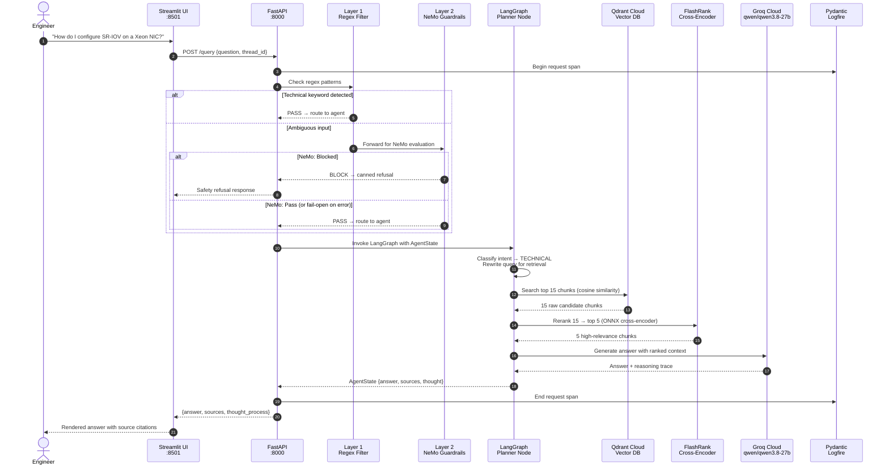
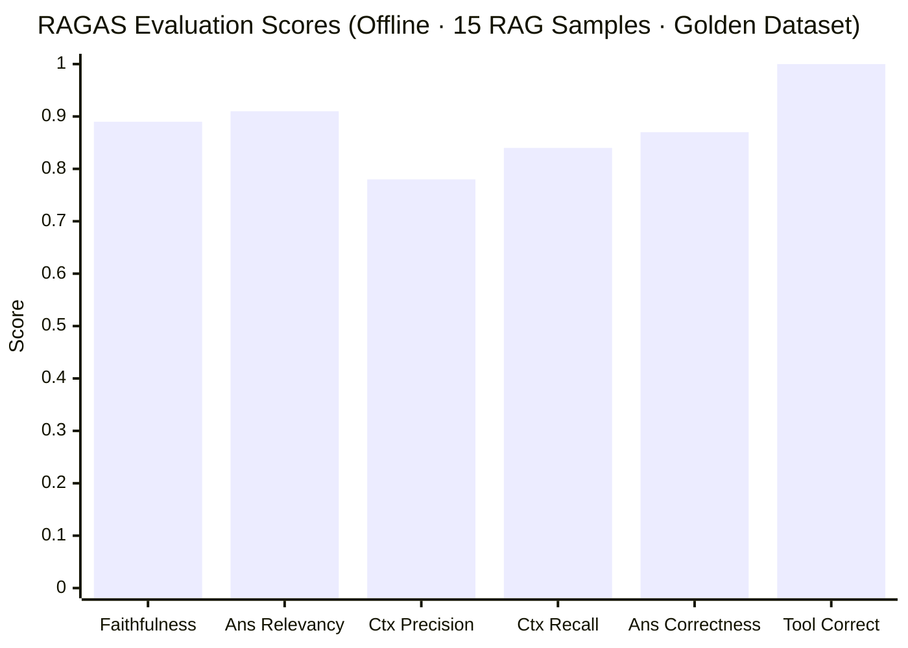

<div align="center">


<br/>


<br/><br/>

<!-- RAGAS Score Badges -->


<br/><br/>

<a href="https://github.com/kingspy89/production-advance-rag/stargazers">
  
</a>
<a href="https://github.com/kingspy89/production-advance-rag/network/members">
  
</a>
<a href="https://github.com/kingspy89/production-advance-rag/issues">
  
</a>
<a href="https://github.com/kingspy89/production-advance-rag/blob/main/LICENSE">
  
</a>


<br/><br/>

<!-- Quick Action Buttons -->
<a href="#-quick-start">
  
</a>
<a href="#-evaluation--benchmark-results">
  
</a>
<a href="#-system-architecture">
  
</a>

</div>

---

## 📋 Table of Contents

| | Section |
|:---:|---|
| [🤖](#-what-is-infraagent) | What is InfraAgent? |
| [⚔️](#️-why-infraagent-the-problem-with-alternatives) | Why InfraAgent — Problem vs Alternatives |
| [✨](#-key-capabilities) | Key Capabilities |
| [🏗️](#️-system-architecture) | System Architecture |
| [🔄](#-request-lifecycle) | Request Lifecycle (Sequence Diagram) |
| [📊](#-evaluation--benchmark-results) | Evaluation & Benchmark Results |
| [💻](#-api-usage-examples) | API Usage Examples |
| [🛠️](#️-technology-stack) | Technology Stack |
| [📁](#-project-structure) | Project Structure |
| [🚀](#-quick-start) | Quick Start |
| [🧪](#-running-evaluations) | Running Evaluations |
| [🗺️](#️-roadmap) | Roadmap |
| [⚠️](#️-limitations--engineering-considerations) | Limitations & Engineering Considerations |
| [🤝](#-contributing) | Contributing |

---

## 🤖 What is InfraAgent?

<div align="center">

</div>

<br/>

**InfraAgent** is a production-grade **Enterprise Agentic RAG** system built for complex IT infrastructure domains:

<div align="center">

| Domain | Topics Covered |
|--------|---------------|
| ☸️ **Kubernetes** | Cluster operations, workloads, RBAC, networking, storage, HPA/VPA |
| 🔷 **Intel Hardware** | Xeon CPUs, FPGAs, SR-IOV, NICs, NUMA topology, acceleration libraries |
| 🌐 **Enterprise Networking** | BGP, SDN, VLANs, TCP/IP stack, QoS, overlay networks |

</div>

> **The problem:** Standard LLMs hallucinate CLI flags, miss private documentation, and cannot reason over your proprietary infrastructure manuals. Naive RAG floods prompts with 15+ noisy, unranked chunks — increasing cost and degrading answer quality.
>
> **The solution:** InfraAgent orchestrates a **LangGraph state machine** for intent-aware retrieval, applies **FlashRank cross-encoder reranking** to surgically compress context from 15 → 5 candidates, and enforces a **two-layer NeMo + Regex safety system** to block unsafe inputs before they ever touch the LLM.

---

## ⚔️ Why InfraAgent — The Problem with Alternatives

<div align="center">

| Capability | Plain LLM | Naive RAG | **InfraAgent** |
|------------|:---------:|:---------:|:--------------:|
| Grounded on private docs | ❌ | ✅ | ✅ |
| Intent-aware query rewriting | ❌ | ❌ | ✅ |
| Cross-encoder reranking (signal over noise) | ❌ | ❌ | ✅ |
| Safety / prompt injection filtering | ❌ | ❌ | ✅ |
| Multi-format ingestion (PDF, HTML, DOCX) | ❌ | ⚠️ Partial | ✅ |
| Stateful multi-turn conversations | ❌ | ❌ | ✅ |
| Automated evaluation (RAGAS) | ❌ | ❌ | ✅ |
| Structured observability (Logfire + LangSmith) | ❌ | ❌ | ✅ |
| Dimension-safe dual embedding providers | ❌ | ❌ | ✅ |

</div>

---

## ✨ Key Capabilities

<table>
<tr>
<td width="50%" valign="top">

### 🧠 Stateful Agentic Orchestration
LangGraph compiled state machine with a **Planner → Router → Retriever/Responder** pipeline. The Planner classifies intent and rewrites queries before retrieval. Conversation threads persist via `MemorySaver` checkpointing.

</td>
<td width="50%" valign="top">

### 🎯 Coarse-to-Fine Retrieval
**15 candidates** from Qdrant Cloud via cosine similarity → **top 5** selected by FlashRank ONNX cross-encoder (`ms-marco-MiniLM-L-6-v2`). **67% reduction in candidate count** before generation; token reduction is proportional to chunk sizes.

</td>
</tr>
<tr>
<td width="50%" valign="top">

### 🛡️ Two-Layer Hybrid Guardrails
**Layer 1** — sub-millisecond regex pre-filter (injections, jailbreaks, greetings, technical keywords with typo-tolerance, no LLM call). **Layer 2** — LLM-backed NeMo Guardrails Colang flow for ambiguous inputs. Intentional **fail-open** on API error — engineers are never blocked during incidents.

</td>
<td width="50%" valign="top">

### 📄 Multi-Format Document Ingestion
**PDF** (`pypdf` + `pdfplumber` fallback), **HTML** (`beautifulsoup4`), **Word** (`python-docx`), **PowerPoint** (`python-pptx`), plain text — all with 1,500-character paragraph-aware chunking and automatic Qdrant upsert.

</td>
</tr>
<tr>
<td width="50%" valign="top">

### 🔢 Dual Embedding + Runtime Validation
**Gemini** `gemini-embedding-2-preview` (3,072-dim) or **local SentenceTransformers** `all-mpnet-base-v2` (768-dim). Query vector dimensions validated against Qdrant collection schema at runtime — no silent mismatch failures.

</td>
<td width="50%" valign="top">

### 📊 Automated RAGAS Evaluation Suite
Streamlit eval dashboard + headless CLI runner (`evals/pipeline.py`). **6 RAGAS metrics** scored against a **21-case golden dataset** (15 RAG + 6 guardrail). Judge: `llama-3.1-8b-instant` via separate Groq API key.

</td>
</tr>
<tr>
<td width="50%" valign="top">

### 🔭 Distributed Observability
**Pydantic Logfire** for structured request/retrieval span tracing (headless-offline fallback). **LangSmith** for full state graph execution inspection. Operational `/health` probe for dependency checking.

</td>
<td width="50%" valign="top">

### 🔀 Provider Routing & Fallback Gateway
**Portkey Gateway** sits between the agent and Groq Cloud for provider-level routing, fallback, and model aliasing. Active production model: **`qwen/qwen3.8-27b`** (configurable via `GROQ_MODEL`).

</td>
</tr>
</table>

---

## 🏗️ System Architecture

```mermaid
flowchart TD
    User([👤 User / Engineer]) --> UI["🖥️ Streamlit Chat\n:8501"]
    UI --> API["⚡ FastAPI REST\n:8000 /query"]

    subgraph Safety_Layer ["🛡️ Two-Layer Guardrails"]
        API --> L1{"⚡ Layer 1\nRegex Filter\nsub-millisecond"}
        L1 -- "🚫 Disallowed / Greeting" --> FastResp["Direct Response\n(no LLM call)"]
        L1 -- "❓ Ambiguous" --> L2["🧠 Layer 2\nNeMo Guardrails\nColang Flow"]
        L2 -- "🔴 Blocked" --> FastResp
    end

    L1 -- "✅ Technical Match" --> Agent
    L2 -- "✅ Pass" --> Agent
    L2 -. "⚠️ Error: fail-open bypass" .-> Agent

    subgraph Agent ["🤖 LangGraph Agent Engine"]
        Planner["🧠 Planner Node\nIntent Classification & Query Refinement"]
        Planner --> RouteDecision{"Routing\nDecision"}
        RouteDecision -- "💬 Conversational" --> Responder["📝 Responder Node"]
        RouteDecision -- "🔍 Technical" --> Retriever["📚 Retriever Node"]

        Retriever --> Qdrant[("🗄️ Qdrant Cloud\nTop 15 Chunks")]
        Qdrant --> FlashRank["⚡ FlashRank\nONNX Cross-Encoder\nTop 5 Chunks"]
        FlashRank --> Responder

        Checkpointer[("💾 MemorySaver\nThread Session State")] <--> Agent
    end

    subgraph Provider_Layer ["☁️ LLM Provider & Gateway"]
        Responder --> Portkey["🔀 Portkey Gateway\nRouting & Fallback"]
        Portkey --> Groq["🚀 Groq Cloud\nqwen/qwen3.8-27b"]
    end

    Groq --> FinalResponse(["✨ Answer + Thought Process + Sources"])
    FinalResponse --> UI

    subgraph Observability ["📡 Telemetry & Evaluation"]
        EvalApp["📊 Eval Dashboard\n:8502"] -.-> API
        API -.-> Logfire["🔥 Pydantic Logfire"]
        Agent -.-> LangSmith["🦜 LangSmith"]
    end
```

---

## 🔄 Request Lifecycle

> How a single engineer query flows end-to-end through InfraAgent:



---

## 📊 Evaluation & Benchmark Results

> ⚠️ All scores are **offline local evaluation results** — not production-observed metrics. Results are captured in the Streamlit eval session; no results are auto-persisted to disk.

### 📈 RAGAS Score Overview



### 🎯 Detailed RAGAS Metric Results

Scored against **15 RAG questions** (IDs 1–15). Judge LLM: `llama-3.1-8b-instant` (Groq, separate `JUDGE_GROQ` key). Evaluation embeddings: `sentence-transformers/all-MiniLM-L6-v2`. Batch size: 1, with 40s inter-sample and 62s inter-experiment cooldowns for Groq TPM compliance.

<div align="center">

| Metric | Score | Bar | Target | Notes |
|--------|:-----:|-----|--------|-------|
| 🔵 **Faithfulness** | **`0.89`** | `▓▓▓▓▓▓▓▓▓░` | Grounding | Answers strictly derived from retrieved docs |
| 🟢 **Answer Relevancy** | **`0.91`** | `▓▓▓▓▓▓▓▓▓░` | Intent Alignment | Directly satisfies the query without digressions |
| 🟡 **Context Precision** | **`0.78`** | `▓▓▓▓▓▓▓▓░░` | Retrieval Quality | Ground-truth context ranked at top. *Baseline (raw cosine): 0.59 → +0.19 absolute gain with FlashRank* |
| 🔵 **Context Recall** | **`0.84`** | `▓▓▓▓▓▓▓▓░░` | Retrieval Completeness | All reference facts captured in retrieved chunks |
| 🟢 **Answer Correctness** | **`0.87`** | `▓▓▓▓▓▓▓▓▓░` | End-to-End Accuracy | Semantic + factual alignment with reference answers |
| ✅ **Tool Correctness** | **`1.00`** | `▓▓▓▓▓▓▓▓▓▓` | Routing Accuracy | Correct tool selected on all 15 samples (Jaccard) |

</div>

### 🛡️ Guardrail Classification Results

Evaluated via `evals/guardrails_eval.py` across the 6 golden safety scenarios (3 adversarial + 3 legitimate):

<div align="center">

| Test Category | Samples | Expected | Actual | Status |
|---------------|:-------:|----------|--------|:------:|
| 💀 Adversarial Injections / Jailbreaks | 3 | Block → Canned Refusal | 3 Blocked | ✅ |
| ✅ Legitimate Technical Inquiries | 3 | Pass → RAG Pipeline | 3 Passed | ✅ |

</div>

> ⚠️ **Scope:** These 6 scenarios validate correct classification on the curated golden set. They do **not** establish general adversarial robustness across novel injection techniques or the full jailbreak space.

### ⚡ Context Reduction Benchmark

<div align="center">

| Stage | Candidates | Engine | Reduction |
|-------|:----------:|--------|:---------:|
| 🔍 Vector Search | **15 chunks** | Qdrant Cloud — Cosine Similarity | — |
| ⚡ Cross-Encoder Rerank | **5 chunks** | FlashRank `ms-marco-MiniLM-L-6-v2` (ONNX) | **↓ 67% candidate count** |

*Token reduction is proportional to individual chunk sizes and is a secondary effect of this candidate reduction.*

</div>

---

## 💻 API Usage Examples

### cURL — Single Query

```bash
curl -X POST http://127.0.0.1:8000/query \
  -H "Content-Type: application/json" \
  -d '{
    "question": "How do I configure SR-IOV virtual functions on an Intel X710 NIC?",
    "thread_id": "session-001"
  }'
```

<details>
<summary>📄 Example Response</summary>

```json
{
  "answer": "To configure SR-IOV on an Intel X710 NIC, first enable SR-IOV in the BIOS under PCIe settings. Then load the i40e driver and set the number of virtual functions via: echo 4 > /sys/class/net/eth0/device/sriov_numvfs. Verify with: ip link show eth0. Assign VFs to VMs using the PCI device address reported by lspci.",
  "sources": [
    {
      "content": "Intel X710 SR-IOV configuration requires BIOS PCIe SR-IOV support enabled...",
      "score": 0.94,
      "filename": "x710_nic_admin_guide.pdf",
      "page": 47
    }
  ],
  "thought_process": "User asked a technical SR-IOV configuration question. Classified as TECHNICAL. Retrieved 15 chunks, reranked to top 5. Generated grounded answer.",
  "tool_used": "retrieve_documents"
}
```

</details>

### Python — Using `requests`

```python
import requests

response = requests.post(
    "http://127.0.0.1:8000/query",
    json={
        "question": "What are the NUMA topology best practices for Kubernetes pod scheduling on multi-socket Xeon servers?",
        "thread_id": "my-session-42"   # same thread_id = stateful multi-turn
    }
)

data = response.json()
print(data["answer"])
print("\n📚 Sources:")
for src in data["sources"]:
    print(f"  [{src['score']:.2f}] {src['filename']} — page {src.get('page', 'N/A')}")
```

### Python — Multi-Turn Conversation (same `thread_id`)

```python
import requests

BASE = "http://127.0.0.1:8000"
THREAD = "infra-debug-session-99"

turns = [
    "Explain BGP route reflectors in a Kubernetes network fabric.",
    "How does that interact with Calico's BGP peering model?",
    "What RBAC changes are needed for Calico's BGP operator?"
]

for turn in turns:
    r = requests.post(f"{BASE}/query", json={"question": turn, "thread_id": THREAD})
    print(f"Q: {turn}")
    print(f"A: {r.json()['answer']}\n{'─'*60}")
```

### Health Check

```bash
curl http://127.0.0.1:8000/health
# {"status": "ok", "qdrant": "connected", "embedding_dim": 768}
```

---

## 🛠️ Technology Stack

<div align="center">

</div>

<br/>

<div align="center">

| Layer | Technology | Version / Detail |
|-------|-----------|-----------------|
| 🐍 **Runtime** | Python | 3.10+ |
| 📦 **Data Validation** | Pydantic v2 | Settings management + schema |
| ⚡ **API Backend** | FastAPI + Uvicorn | ASGI, `/query`, `/health`, `/graph` |
| 🤖 **Agent Engine** | LangGraph + LangChain Core | StateGraph, conditional edges, checkpointing |
| 🗄️ **Vector Database** | Qdrant Cloud | `query_points` API, cosine similarity |
| ⚡ **Reranker** | FlashRank (ONNX) | `ms-marco-MiniLM-L-6-v2` — local, no API call |
| 🛡️ **Safety Layer** | NVIDIA NeMo Guardrails + Regex | Two-layer hybrid, fail-open semantics |
| 🔢 **Embeddings** | Gemini `gemini-embedding-2-preview` (3072-dim) / SentenceTransformers `all-mpnet-base-v2` (768-dim) | Runtime dimension validation |
| 🚀 **LLM Inference** | Groq Cloud — `qwen/qwen3.8-27b` | Sub-second inference |
| 🔀 **Gateway** | Portkey | Provider routing, model aliasing, fallback |
| 📄 **Document Parsers** | pypdf, pdfplumber, beautifulsoup4, python-docx, python-pptx | Multi-format ingestion |
| 📊 **Evaluation** | RAGAS + Pandas | 6-metric automated eval harness |
| 🔭 **Observability** | Pydantic Logfire + LangSmith | Span tracing + graph inspection |
| 🖥️ **UI** | Streamlit | Chat :8501, Eval dashboard :8502 |
| 🐳 **Container** | Docker | Single-container manifest |

</div>

---

## 📁 Project Structure

```text
production-advance-rag/
│
├── 📂 app/                            # Core application
│   ├── main.py                        # FastAPI entrypoint — /health, /graph, /query
│   ├── config.py                      # Pydantic Settings — env schema & model routing
│   │
│   ├── 📂 agents/                     # LangGraph state machine
│   │   ├── graph.py                   # StateGraph assembly, edges & MemorySaver
│   │   ├── state.py                   # TypedDict AgentState schema
│   │   └── 📂 nodes/                  # Planner, Retriever, Responder nodes
│   │
│   ├── 📂 gateway/
│   │   └── client.py                  # Portkey wrapper + direct Groq fallback
│   │
│   ├── 📂 guardrails/
│   │   ├── rails.py                   # Regex engine, NeMo adapter & fail-open logic
│   │   └── colang_rules.py            # Colang policies & technical keyword allowlist
│   │
│   ├── 📂 ingestion/
│   │   ├── processor.py               # Batch ingestion CLI, chunking & Qdrant upsert
│   │   ├── 📂 chunking/               # 1500-char paragraph-aware text splitter
│   │   └── 📂 loaders/                # PDF, HTML, DOCX, PPTX, TXT parsers
│   │
│   └── 📂 services/retrieval/
│       ├── embedding.py               # Dual-provider embedding (Gemini / SentenceTransformers)
│       ├── qdrant_service.py          # Qdrant search + runtime dimension validation
│       └── ranking_service.py         # FlashRank local ONNX cross-encoder
│
├── 📂 evals/                          # Automated evaluation framework
│   ├── app.py                         # Streamlit eval dashboard (:8502)
│   ├── pipeline.py                    # Live API evaluation orchestrator
│   ├── metrics.py                     # 6 RAGAS metric implementations
│   ├── guardrails_eval.py             # Binary classification harness
│   └── golden_dataset.json            # 21-sample ground-truth dataset
│
├── 📂 ui/
│   ├── app.py                         # Streamlit chat interface (:8501)
│   └── st_cloud_ui.py                 # In-process Streamlit deployment variant
│
├── .env.example                       # Environment configuration template
├── Dockerfile                         # Container build manifest
└── requirements.txt                   # Pinned production dependencies
```

---

## 🚀 Quick Start

### ⚡ 30-Second Docker Quick Start

```bash
git clone https://github.com/kingspy89/production-advance-rag.git
cd production-advance-rag
cp .env.example .env          # fill in GROQ_API_KEY and QDRANT_CLUSTER_ENDPOINT
docker build -t infraagent .
docker run -p 8000:8000 --env-file .env infraagent
```

Then hit `http://localhost:8000/health` to confirm it's live.

---

### Manual Installation

#### Prerequisites

| | Requirement | Notes |
|:-:|-------------|-------|
| 🐍 | Python 3.10+ | Tested on 3.10, 3.11 |
| 🗄️ | Qdrant Cloud account | Or run `docker run -p 6333:6333 qdrant/qdrant` locally |
| 🔑 | Groq API Key | Free tier at [console.groq.com](https://console.groq.com) |
| 🔑 | Gemini API Key | **Optional** — only if using `EMBEDDING_PROVIDER=gemini` |

#### Step 1 — Clone & Install

```bash
git clone https://github.com/kingspy89/production-advance-rag.git
cd production-advance-rag

python -m venv .venv
source .venv/bin/activate          # Linux / macOS
# .venv\Scripts\activate           # Windows PowerShell

pip install --upgrade pip
pip install -r requirements.txt
```

#### Step 2 — Configure Environment

```bash
cp .env.example .env
```

```dotenv
# ── Vector Database ──────────────────────────────────────────────────
QDRANT_CLUSTER_ENDPOINT=https://your-cluster.us-east.aws.cloud.qdrant.io:6333
QDRANT_API_KEY=your_qdrant_api_key

# ── LLM Inference ────────────────────────────────────────────────────
GROQ_API_KEY=your_groq_api_key
GROQ_MODEL=qwen/qwen3.8-27b       # active production model
GUARD_MODEL=qwen/qwen3.8-27b      # model used by NeMo guardrail layer

# ── Embeddings ───────────────────────────────────────────────────────
# 'local' = 768-dim all-mpnet-base-v2, no API key required
# 'gemini' = 3072-dim gemini-embedding-2-preview, requires GEMINI_API_KEY
EMBEDDING_PROVIDER=local
GEMINI_API_KEY=

# ── Evaluation Judge (separate key avoids rate-limit contention) ──────
JUDGE_GROQ=your_groq_api_key_for_ragas_judge

# ── Observability (Optional) ─────────────────────────────────────────
LOGFIRE_TOKEN=
LANGSMITH_TRACING=false
LANGSMITH_API_KEY=
```

#### Step 3 — Ingest Documents

```bash
# Drop your PDFs, HTML, DOCX, PPTX, TXT files into a DATA/ folder, then:
python -m app.ingestion.processor DATA --wipe
# --wipe creates a fresh Qdrant collection matching the active embedding dim
```

#### Step 4 — Launch All Services

```bash
# Terminal 1 — FastAPI backend
uvicorn app.main:app --host 127.0.0.1 --port 8000 --reload

# Terminal 2 — Chat UI
streamlit run ui/app.py --server.port 8501

# Terminal 3 — Evaluation Dashboard (optional)
streamlit run evals/app.py --server.port 8502
```

<div align="center">

| 🌐 Service | URL | Purpose |
|-----------|-----|---------|
| 🖥️ Chat Interface | http://127.0.0.1:8501 | Main conversational UI |
| 📄 Swagger API Docs | http://127.0.0.1:8000/docs | Interactive REST endpoint explorer |
| ❤️ Health Probe | http://127.0.0.1:8000/health | Dependency connectivity check |
| 🗺️ Graph Topology | http://127.0.0.1:8000/graph | LangGraph workflow rendered as image |
| 📊 Eval Dashboard | http://127.0.0.1:8502 | 3-step RAGAS evaluation pipeline |

</div>

---

## 🧪 Running Evaluations

InfraAgent ships a **three-stage automated evaluation pipeline**:

```
┌─────────────────────────────────────────────────────────────────┐
│  Step 1 → Review Ground Truth                                   │
│           Inspect 21 golden samples from golden_dataset.json    │
│                                                                  │
│  Step 2 → Live Pipeline Execution                               │
│           Fire all queries at POST /query                        │
│           Capture: answers, contexts, tools, guardrail labels    │
│                                                                  │
│  Step 3 → RAGAS Metric Scoring                                  │
│           Judge model scores 6 metrics on 15 RAG samples        │
│           Guardrail binary classification on 6 safety samples    │
└─────────────────────────────────────────────────────────────────┘
```

```bash
# Ensure FastAPI is running on :8000, then launch the eval dashboard:
streamlit run evals/app.py --server.port 8502

# Or run headless (no Streamlit):
python -m evals.pipeline
```

> 💡 **Rate limit note:** Judge LLM scoring uses 40s inter-sample + 62s inter-experiment cooldowns to stay within Groq's 6,000 TPM free-tier cap. Use a dedicated `JUDGE_GROQ` key to avoid contention with the main API key.

---

## 🗺️ Roadmap

<div align="center">

| Status | Feature | Notes |
|:------:|---------|-------|
| ✅ | LangGraph stateful agent | `MemorySaver` checkpointing |
| ✅ | Two-layer NeMo + Regex guardrails | Fail-open on error |
| ✅ | FlashRank ONNX cross-encoder reranking | 15 → 5 candidates |
| ✅ | Dual embedding providers (Gemini / Local) | Runtime dimension validation |
| ✅ | RAGAS automated evaluation suite | 21-sample golden dataset |
| ✅ | Pydantic Logfire + LangSmith observability | Span tracing |
| ✅ | Multi-format document ingestion | PDF, HTML, DOCX, PPTX, TXT |
| 🔜 | Persistent `PostgresSaver` checkpointing | Cross-restart session durability |
| 🔜 | Expanded golden dataset (50+ samples) | Broader domain coverage |
| 🔜 | Hybrid BM25 + dense retrieval | Sparse-dense fusion for rare terms |
| 🔜 | Real-time eval result persistence to disk | JSON/CSV export from eval pipeline |
| 🔜 | CI/CD integration for eval regression | Auto-run eval on PR merge |
| 💡 | GraphRAG / knowledge graph layer | Entity-aware retrieval |
| 💡 | OpenTelemetry export | Vendor-neutral tracing |

</div>

---

## ⚠️ Limitations & Engineering Considerations

<details>
<summary><b>🔢 Embedding Dimension Incompatibility & Re-Indexing</b></summary>
<br/>

Gemini embeddings are **3,072-dimensional**; local `all-mpnet-base-v2` produces **768-dimensional** vectors. These live in incompatible semantic spaces — distance metrics cannot cross dimensions. The app validates `collection_dim == query_dim` at query time and raises a `ValueError` on mismatch. Switching providers requires full re-indexing:

```bash
python -m app.ingestion.processor DATA --wipe
```

</details>

<details>
<summary><b>🛡️ Guardrail Failure Semantics — Intentional Fail-Open</b></summary>
<br/>

Layer 1 regex runs in-process (zero latency). Layer 2 (NeMo) makes an **external LLM call**. If that call times out or raises an exception, the system **intentionally fails open** — it logs a `WARNING` and allows the query through to the LangGraph agent. This is an engineering choice: infrastructure operators must **never** be locked out of diagnostic tooling during a live incident. The fail-open path is an exception handler, not a normal routing decision.

</details>

<details>
<summary><b>💾 In-Memory Agent Checkpointing</b></summary>
<br/>

`MemorySaver` persists conversation threads in process memory only. **Restarting the backend resets all session state.** For production durability, replace in `app/agents/graph.py`:

```python
# Development (default)
checkpointer = MemorySaver()

# Production (persistent)
from langgraph.checkpoint.sqlite import SqliteSaver
checkpointer = SqliteSaver.from_conn_string("checkpoints.db")
```

</details>

<details>
<summary><b>📊 Evaluation Dataset Scale</b></summary>
<br/>

The golden dataset contains **21 curated scenarios** (15 RAG + 6 guardrail). RAGAS scores represent a single offline evaluation session — results are not automatically persisted to disk. For enterprise validation, broader domain coverage across more document types and edge-case queries is advisable.

</details>

<details>
<summary><b>⏱️ Provider Latency & Cold Start</b></summary>
<br/>

LLM generation latency depends on Groq API availability and network conditions. The FlashRank ONNX cross-encoder model is lazily loaded on first use — the first request after cold start incurs a minor delay while the model loads into memory. Subsequent requests use the cached model.

</details>

---

## 🤝 Contributing

Contributions, bug reports, and feature requests are welcome!

```bash
# 1. Fork the repo and clone your fork
git clone https://github.com/YOUR_USERNAME/production-advance-rag.git

# 2. Create a feature branch
git checkout -b feat/your-feature-name

# 3. Make changes and run the eval pipeline to verify nothing regressed
python -m evals.pipeline

# 4. Commit with a descriptive message
git commit -m "feat: add hybrid BM25+dense retrieval"

# 5. Push and open a Pull Request against main
git push origin feat/your-feature-name
```

**Good first issues:** expanding the golden dataset, adding `PostgresSaver` checkpointing, BM25 hybrid retrieval, or CI eval regression checks.

---

## 📚 Further Resources

<div align="center">

| Resource | Link |
|----------|------|
| 📖 Interactive API Docs | `/docs` — Swagger UI (live when backend is running) |
| 🗺️ Workflow Topology | `/graph` — Compiled LangGraph state machine rendered as PNG |
| 🦜 LangGraph Docs | [langchain-ai.github.io/langgraph](https://langchain-ai.github.io/langgraph/) |
| 🗄️ Qdrant Docs | [qdrant.tech/documentation](https://qdrant.tech/documentation/) |
| 🛡️ NeMo Guardrails | [github.com/NVIDIA/NeMo-Guardrails](https://github.com/NVIDIA/NeMo-Guardrails) |
| 📊 RAGAS Docs | [docs.ragas.io](https://docs.ragas.io/) |
| 🚀 Groq Console | [console.groq.com](https://console.groq.com/) |
| ⚡ FlashRank | [github.com/PrithivirajDamodaran/FlashRank](https://github.com/PrithivirajDamodaran/FlashRank) |

</div>

---

<div align="center">


**Built with 🔥 by [kingspy89](https://github.com/kingspy89)**


*If this project helped you — drop a ⭐ star. It genuinely helps!*

</div>
