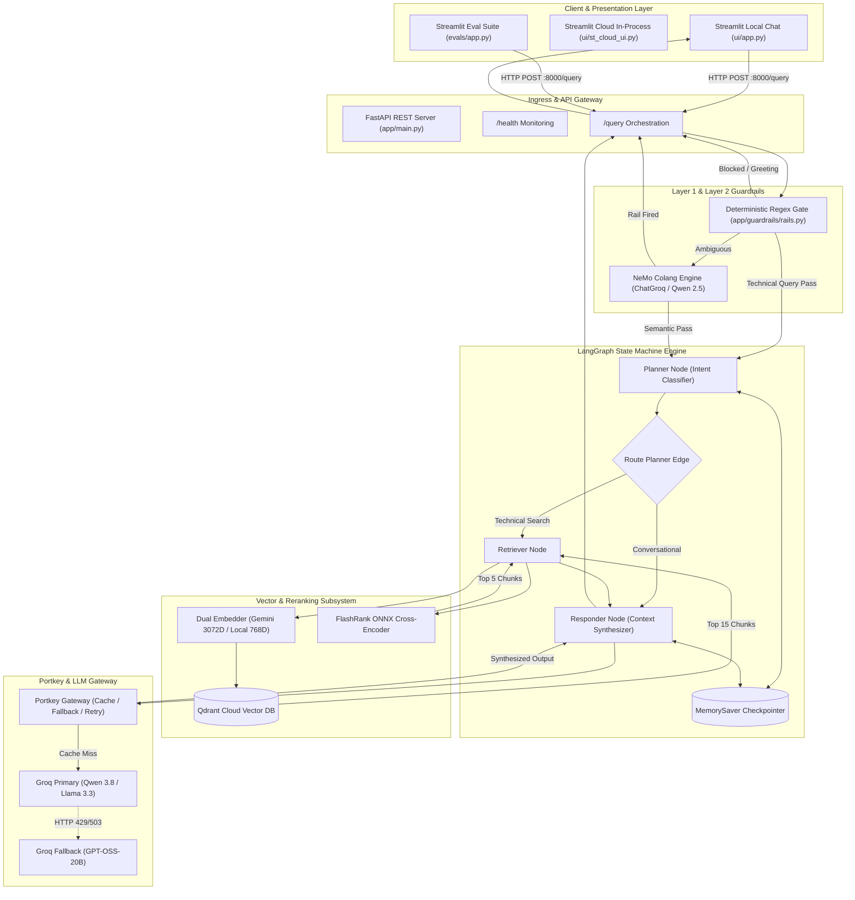
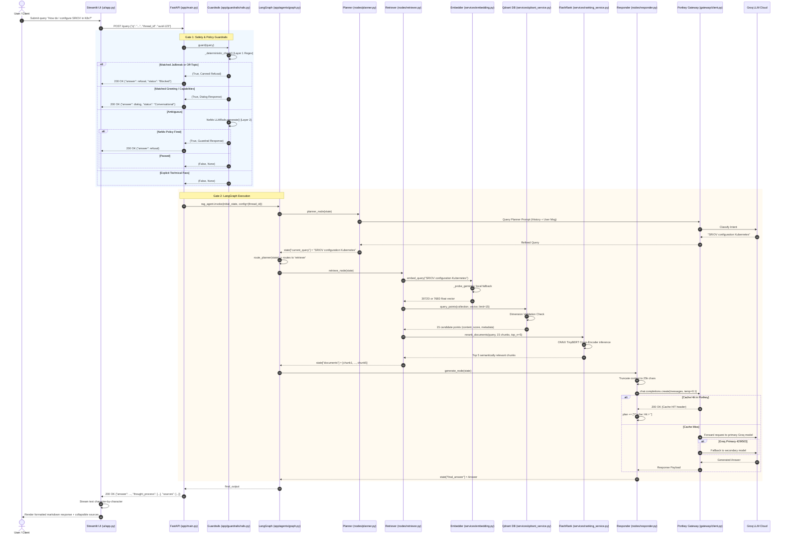
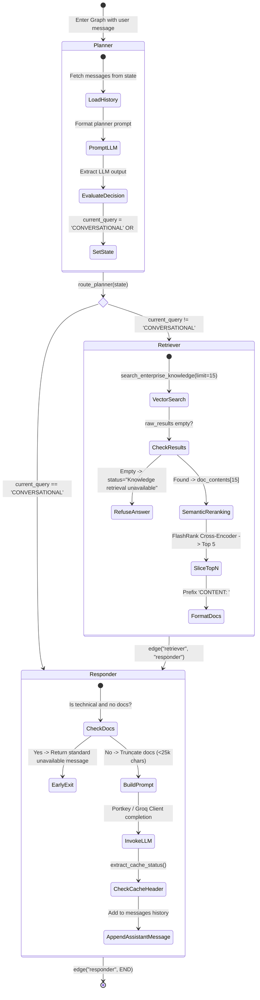
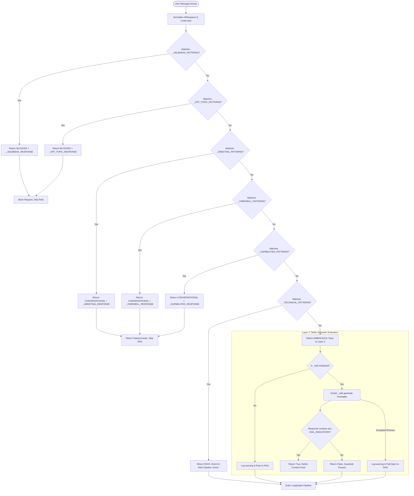
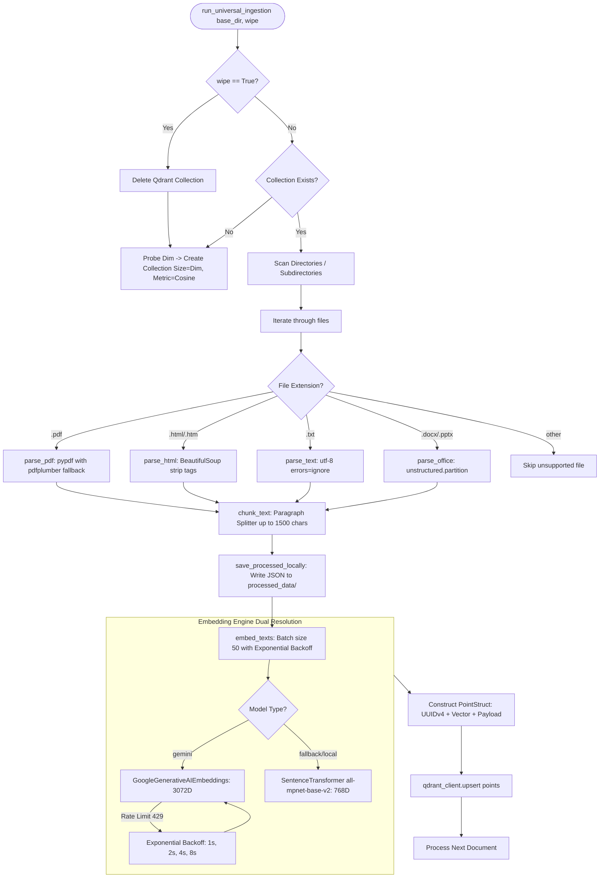
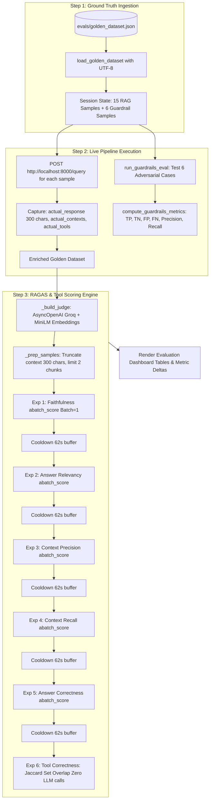
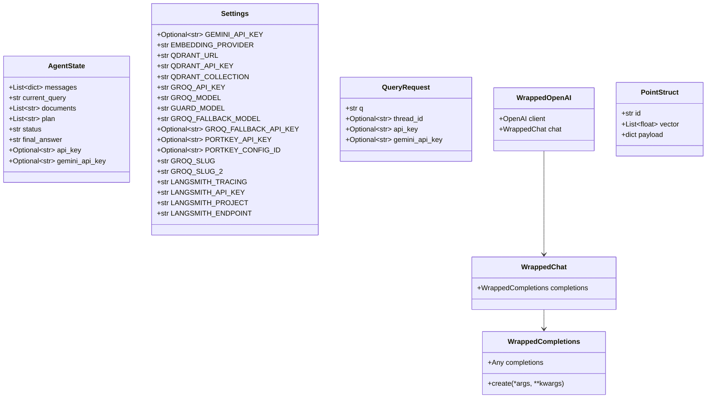

# 🏛️ Enterprise Agentic RAG — Comprehensive Low-Level Design (LLD) Specification

**Document Version:** 2.0.0  
**Status:** Approved / Production Hardened  
**Target Systems:** Enterprise Kubernetes, Intel Xeon/FPGA Architecture, SDN/Enterprise Networking  
**Classification:** Technical Architecture & Implementation Specification  

---

## 📑 Table of Contents
1. [Executive Architecture Overview](#1-executive-architecture-overview)
2. [End-to-End System Flowcharts & Visual Sequences](#2-end-to-end-system-flowcharts--visual-sequences)
   - [2.1 High-Level Component Topology](#21-high-level-component-topology)
   - [2.2 Complete Request Lifecycle Sequence Diagram](#22-complete-request-lifecycle-sequence-diagram)
   - [2.3 LangGraph State Machine Diagram](#23-langgraph-state-machine-diagram)
   - [2.4 Two-Layer Hybrid Guardrails Decision Tree](#24-two-layer-hybrid-guardrails-decision-tree)
   - [2.5 Ingestion & Embedding Pipeline Flow](#25-ingestion--embedding-pipeline-flow)
   - [2.6 Evaluation Pipeline & RAGAS Benchmarking Flow](#26-evaluation-pipeline--ragas-benchmarking-flow)
3. [Core Class & State Data Models](#3-core-class--state-data-models)
4. [Module-by-Module Low-Level Functional Design](#4-module-by-module-low-level-functional-design)
   - [4.1 Configuration Management (`app/config.py`)](#41-configuration-management-appconfigpy)
   - [4.2 Application Entrypoint & API Layer (`app/main.py`)](#42-application-entrypoint--api-layer-appmainpy)
   - [4.3 Agentic Orchestration (`app/agents/`)](#43-agentic-orchestration-appagents)
     - [4.3.1 Graph State Definition (`app/agents/state.py`)](#431-graph-state-definition-appagentsstatepy)
     - [4.3.2 Graph Topology & Checkpointing (`app/agents/graph.py`)](#432-graph-topology--checkpointing-appagentsgraphpy)
     - [4.3.3 Planner Node (`app/agents/nodes/planner.py`)](#433-planner-node-appagentsnodesplannerpy)
     - [4.3.4 Retriever Node (`app/agents/nodes/retriever.py`)](#434-retriever-node-appagentsnodesretrieverpy)
     - [4.3.5 Responder Node (`app/agents/nodes/responder.py`)](#435-responder-node-appagentsnodesresponderpy)
   - [4.4 LLM Gateway & Semantic Caching (`app/gateway/client.py`)](#44-llm-gateway--semantic-caching-appgatewayclientpy)
   - [4.5 Hybrid Safety & Guardrails (`app/guardrails/`)](#45-hybrid-safety--guardrails-appguardrails)
     - [4.5.1 Guard Engine (`app/guardrails/rails.py`)](#451-guard-engine-appguardrailsrailspy)
     - [4.5.2 Colang Specs & Policy Indicators (`app/guardrails/colang_rules.py`)](#452-colang-specs--policy-indicators-appguardrailscolang_rulespy)
   - [4.6 Retrieval & Vector Services (`app/services/retrieval/`)](#46-retrieval--vector-services-appservicesretrieval)
     - [4.6.1 Embedding Engine (`app/services/retrieval/embedding.py`)](#461-embedding-engine-appservicesretrievalembeddingpy)
     - [4.6.2 Qdrant Vector DB Service (`app/services/retrieval/qdrant_service.py`)](#462-qdrant-vector-db-service-appservicesretrievalqdrant_servicepy)
     - [4.6.3 Semantic Reranking Service (`app/services/retrieval/ranking_service.py`)](#463-semantic-reranking-service-appservicesretrievalranking_servicepy)
   - [4.7 Document Ingestion Subsystem (`app/ingestion/`)](#47-document-ingestion-subsystem-appingestion)
     - [4.7.1 Semantic Paragraph Splitter (`app/ingestion/chunking/splitter.py`)](#471-semantic-paragraph-splitter-appingestionchunkingsplitterpy)
     - [4.7.2 Multimodal Loaders (`app/ingestion/loaders/`)](#472-multimodal-loaders-appingestionloaders)
     - [4.7.3 Universal Batch Processor (`app/ingestion/processor.py`)](#473-universal-batch-processor-appingestionprocessorpy)
   - [4.8 Automated Evaluation Suite (`evals/`)](#48-automated-evaluation-suite-evals)
     - [4.8.1 Live Pipeline Orchestrator (`evals/pipeline.py`)](#481-live-pipeline-orchestrator-evalspipelinepy)
     - [4.8.2 Guardrails Evaluation Harness (`evals/guardrails_eval.py`)](#482-guardrails-evaluation-harness-evalsguardrails_evalpy)
     - [4.8.3 RAGAS Metrics Engine & Shims (`evals/metrics.py`)](#483-ragas-metrics-engine--shims-evalsmetricspy)
     - [4.8.4 Ground Truth Data Parser (`evals/data_parser.py`)](#484-ground-truth-data-parser-evalsdata_parserpy)
     - [4.8.5 Streamlit Evaluation Dashboard (`evals/app.py`)](#485-streamlit-evaluation-dashboard-evalsapppy)
   - [4.9 User Interface Subsystems (`ui/`)](#49-user-interface-subsystems-ui)
     - [4.9.1 Local UI Application (`ui/app.py`)](#491-local-ui-application-uiapppy)
     - [4.9.2 In-Process Streamlit Cloud Variant (`ui/st_cloud_ui.py`)](#492-in-process-streamlit-cloud-variant-uist_cloud_uipy)
5. [Error Handling, Circuit Breakers & Fail-Open Matrix](#5-error-handling-circuit-breakers--fail-open-matrix)
6. [Telemetry, Tracing & Operational Monitoring](#6-telemetry-tracing--operational-monitoring)

---

## 1. Executive Architecture Overview

The **Enterprise Agentic RAG** system is engineered to deliver high-precision, sub-second technical answers across deep IT domains (Kubernetes clusters, Intel hardware accelerators, SRIOV, BGP, and SDN networking).

### Key Architectural Tenets:
1. **Two-Layer Hybrid Guardrails:** Deterministic zero-latency regex matching (Layer 1) filters known jailbreaks, off-topic requests, and greetings; ambiguous queries route through an LLM-backed NeMo Colang engine (Layer 2) with a fail-open posture during API interruptions.
2. **Stateful Graph Orchestration:** LangGraph state machine maintaining conversational memory via `MemorySaver` thread checkpointing.
3. **High-Precision Retrieval Hierarchy:** Bi-encoder vector search in Qdrant retrieves 15 candidates; a quantized local cross-encoder (`FlashRank` ONNX TinyBERT) reranks and compresses to the top 5 chunks (67% chunk reduction, +0.19 Context Precision improvement).
4. **Dual-Embedding Support & Dimension Validation:** Probes Gemini `gemini-embedding-2-preview` (3072-dim) with local SentenceTransformers fallback (`all-mpnet-base-v2`, 768-dim), enforcing query-time collection dimension validation to prevent silent vector mismatches.
5. **Gateway Routing & Fallbacks:** Portkey AI gateway integration and transparent `WrappedOpenAI` proxy providing fallback model routing and automatic retries on HTTP 429/503.

---

## 2. End-to-End System Flowcharts & Visual Sequences

### 2.1 High-Level Component Topology



---

### 2.2 Complete Request Lifecycle Sequence Diagram



---

### 2.3 LangGraph State Machine Diagram



---

### 2.4 Two-Layer Hybrid Guardrails Decision Tree



---

### 2.5 Ingestion & Embedding Pipeline Flow



---

### 2.6 Evaluation Pipeline & RAGAS Benchmarking Flow



---

## 3. Core Class & State Data Models



---

## 4. Module-by-Module Low-Level Functional Design

### 4.1 Configuration Management (`app/config.py`)

#### Purpose
Centralizes all environment variable retrieval, model sanitization guards, fallback configurations, and LangSmith tracing environment propagation.

#### Data Structures & Variables
- `_unsupported_models`: `set = {"openai/gpt-oss-120b", "llama-3.1-8b-instant", "llama-3.3-70b-versatile"}`
- `Settings`: Static class holding all configuration variables.
- `settings`: Singleton instance of `Settings`.

#### Function & Logic Specifications

##### `Settings` Initialization
- **Environment Ingestion:** Invokes `load_dotenv(override=True)` to force project-root `.env` precedence.
- **Model Normalization:** Validates `GROQ_MODEL` and `GUARD_MODEL`. If the environment variable contains an unsupported or deprecated model identifier from `_unsupported_models`, it safely defaults to `"qwen/qwen3.8-27b"`.
- **Tracing Synchronization:** Directly sets `os.environ["LANGCHAIN_TRACING_V2"]`, `os.environ["LANGCHAIN_API_KEY"]`, `os.environ["LANGCHAIN_PROJECT"]`, and `os.environ["LANGCHAIN_ENDPOINT"]` to ensure seamless LangChain and LangGraph telemetry.

---

### 4.2 Application Entrypoint & API Layer (`app/main.py`)

#### Purpose
Exposes the ASGI FastAPI interface, CORS headers, health checks, Mermaid PNG graph visualization, static UI mounting, and the core `/query` orchestration pipeline.

#### Function & Endpoint Specifications

##### `lifespan(app: FastAPI)`
- **Type:** `@asynccontextmanager`
- **Logic:** Invoked on FastAPI startup. Triggers `initialize_rails()` to pre-warm the NeMo Guardrails engine. Yields control to the server, and handles clean teardown.

##### `home() -> dict`
- **Method:** `GET /`
- **Returns:** `{"message": "Enterprise LangGraph RAG API is live."}`

##### `health_check() -> dict`
- **Method:** `GET /health`
- **Purpose:** Operational monitoring probing 4 critical dependencies.
- **Logic Flow:**
  1. **Qdrant DB:** Invokes `qdrant_client.get_collections()`. Verifies cluster reachability and collection count.
  2. **Groq LLM:** Instantiates `get_langchain_llm(feature="health_check")` and executes `test_llm.invoke("ping")`.
  3. **Guardrails:** Inspects `_rails` singleton status. Reports `"up"`, `"disabled"`, or `"deterministic-only"`.
  4. **Portkey Gateway:** Verifies `settings.PORTKEY_API_KEY` presence and reporting caching status.
- **Status Codes:** Returns `"status": "healthy"` if all critical components succeed; `"status": "degraded"` if any dependency fails.

##### `get_graph_image() -> Response`
- **Method:** `GET /graph`
- **Returns:** Raw image bytes (`image/png`) rendered from `rag_agent.get_graph().draw_mermaid_png()`.

##### `query(request: QueryRequest, x_api_key, x_groq_api_key, x_gemini_api_key) -> dict`
- **Method:** `POST /query`
- **Parameters:**
  - `request: QueryRequest` (JSON payload containing query `q`, `thread_id`, and optional API keys)
  - Headers: Optional fallback headers for API key injection.
- **Step-by-Step Logic Flow:**
  1. Resolves `effective_api_key` and `effective_gemini_key` using priority order: Payload -> HTTP Headers -> Environment Variables.
  2. Checks for mandatory API keys; if missing, returns immediate guidance JSON.
  3. Prepares `initial_state`:
     ```python
     {
         "messages": [{"role": "user", "content": q}],
         "current_query": q,
         "documents": [],
         "plan": ["Start"],
         "status": "Initializing Graph...",
         "api_key": effective_api_key,
         "gemini_api_key": effective_gemini_key
     }
     ```
  4. **Gate 1 Execution:** Calls `rail_fired, rail_response = guard(q)`.
     - If `rail_fired == True`: Bypasses LangGraph immediately. Logs to Logfire, and returns canned response with `thought_process: ["Intent: Guardrails Fired", "Retrieval: Skipped"]`.
  5. **Gate 2 Execution:** Executes `rag_agent.invoke(initial_state, config={"configurable": {"thread_id": thread_id}})`.
  6. Returns sanitized response containing `question`, `answer`, `thought_process`, `status`, and `sources`.
- **Exception Handling:** Catches all unhandled exceptions, logs to `logfire.error`, and returns a safe fallback error response preventing 500 server crashes.

---

### 4.3 Agentic Orchestration (`app/agents/`)

#### 4.3.1 Graph State Definition (`app/agents/state.py`)
- **Class:** `AgentState(TypedDict)`
  - `messages: Annotated[List[dict], operator.add]` — Appends conversation history messages immutably.
  - `current_query: str` — Current search query or `'CONVERSATIONAL'` token.
  - `documents: List[str]` — Formatted technical contexts retrieved for synthesis.
  - `plan: List[str]` — Step-by-step reasoning thought process for user transparency.
  - `status: str` — High-level human-readable execution status.
  - `final_answer: str` — Synthesized response string.
  - `api_key: Optional[str]` — User-injected Groq/LLM key.
  - `gemini_api_key: Optional[str]` — User-injected Gemini embedding key.

#### 4.3.2 Graph Topology & Checkpointing (`app/agents/graph.py`)
- **Structure:**
  - Graph initialized with `StateGraph(AgentState)`.
  - Nodes added: `"planner"`, `"retriever"`, `"responder"`.
  - Entrypoint: `"planner"`.
- **Routing Logic (`route_planner`):**
  ```python
  def route_planner(state: AgentState):
      if state["current_query"] == "CONVERSATIONAL":
          return "responder"
      return "retriever"
  ```
- **Checkpointing:** Instantiates `MemorySaver()`, which persists conversations per `thread_id` in RAM across invocations.

#### 4.3.3 Planner Node (`app/agents/nodes/planner.py`)
- **Function:** `planner_node(state: AgentState) -> dict`
- **Execution Logic:**
  1. Instantiates LLM via `get_langchain_llm(feature="planner", api_key=state.get("api_key"))`.
  2. Extracts all conversation messages excluding the current query to build `CONVERSATION HISTORY`.
  3. Crafts a prompt instructing the LLM to either:
     - Output `'CONVERSATIONAL'` if the message is a greeting or can be resolved purely from history.
     - Output a refined search query if the query requires technical documentation retrieval.
  4. Parses LLM completion. If `'CONVERSATIONAL'`, returns `current_query: "CONVERSATIONAL"` and skips retrieval. Otherwise returns the refined search query string.

#### 4.3.4 Retriever Node (`app/agents/nodes/retriever.py`)
- **Function:** `retrieve_node(state: AgentState) -> dict`
- **Execution Logic:**
  1. Extracts `query = state["current_query"]`.
  2. Calls `search_enterprise_knowledge(query, limit=15, gemini_api_key=...)`.
  3. Checks results: If empty, sets status to `"Knowledge retrieval unavailable"` and plan update `"Context Retrieval Failed"`.
  4. If results exist, extracts document text strings and invokes `rerank_documents(query, doc_contents, top_n=5)`.
  5. Formats the top 5 chunks into `"CONTENT: {doc}"` blocks and returns `documents` and plan update.

#### 4.3.5 Responder Node (`app/agents/nodes/responder.py`)
- **Function:** `generate_node(state: AgentState) -> dict`
- **Execution Logic:**
  1. Checks if technical query has empty documents: If so, returns clean refusal message.
  2. Resolves LLM client via `get_llm_client(api_key=state.get("api_key"))`.
  3. Reconstructs conversation history string.
  4. **Context Window Protection:** For technical queries, iterates through documents and truncates total context at 25,000 characters to prevent Groq TPM rate limit overflow.
  5. Executes `llm_client.chat.completions.create(messages=[...], temperature=0.1)`.
  6. **Cache Detection:** Calls `extract_cache_status(response)`. If `HIT`, appends `"Cache: Hit ⚡"` to the execution plan.
  7. Returns `final_answer`, updated `plan`, status, and appends `{"role": "assistant", "content": content}` to state messages.

---

### 4.4 LLM Gateway & Semantic Caching (`app/gateway/client.py`)

#### Purpose
Abstracts provider routing between Portkey AI Gateway (when configured) and direct Groq API execution, providing seamless fallbacks, retries, and semantic caching.

#### Function & Class Specifications

##### `WrappedOpenAI`, `WrappedChat`, `WrappedCompletions`
- **Purpose:** Protocol-compatible wrappers over OpenAI Python SDK when direct Groq execution is active.
- **Key Behavior:** Intercepts `create()` calls and dynamically injects `settings.GROQ_MODEL` if no model is explicitly passed.

##### `get_langchain_llm(feature: str, api_key: str) -> ChatOpenAI`
- **Returns:** Configured `ChatOpenAI` instance.
- **Branch 1 (Portkey):** If `PORTKEY_API_KEY` is present, routes requests through `PORTKEY_GATEWAY_URL` with headers containing fallback configuration across `@rag/model` and `@brag/fallback_model`, simple cache mode, and 2 retry attempts on 429/503.
- **Branch 2 (Direct Groq):** Routes directly to `https://api.groq.com/openai/v1` with `effective_key` and temperature 0.

##### `get_llm_client(api_key: str)`
- **Returns:** Native client instance (`Portkey` client or `WrappedOpenAI`).

##### `extract_cache_status(response) -> str`
- **Defensive Inspection:** Iterates over `("_raw_response", "_response", "_http_response")` to inspect headers for `x-portkey-cache-status`. Returns `"HIT"` or `"MISS"`.

---

### 4.5 Hybrid Safety & Guardrails (`app/guardrails/`)

#### 4.5.1 Guard Engine (`app/guardrails/rails.py`)
- **`_deterministic_check(message: str) -> tuple[str, str | None]`**
  - Normalizes text: `re.sub(r"\s+", " ", message.casefold()).strip()`.
  - Checks regex banks in order:
    1. `_JAILBREAK_PATTERNS` -> `("BLOCKED", _JAILBREAK_RESPONSE)`
    2. `_OFF_TOPIC_PATTERNS` -> `("BLOCKED", _OFF_TOPIC_RESPONSE)`
    3. `_GREETING_PATTERNS` -> `("CONVERSATIONAL", _GREETING_RESPONSE)`
    4. `_FAREWELL_PATTERNS` -> `("CONVERSATIONAL", _FAREWELL_RESPONSE)`
    5. `_CAPABILITIES_PATTERNS` -> `("CONVERSATIONAL", _CAPABILITIES_RESPONSE)`
    6. `_TECHNICAL_PATTERNS` -> `("PASS", None)`
    7. Default -> `("AMBIGUOUS", None)`
- **`initialize_rails(api_key: str | None = None) -> None`**
  - Instantiates `ChatGroq(model=GUARD_MODEL, temperature=0)` wrapped in `LangChainLLMAdapter`.
  - Compiles `RailsConfig.from_content(colang_content=COLANG_CONTENT, yaml_content=config_yaml)`.
  - Assigns singleton `_rails = LLMRails(config, llm=adapter)`.
- **`guard(message: str) -> tuple[bool, str | None]`**
  - Evaluates Layer 1 (`_deterministic_check`).
  - If `"AMBIGUOUS"`, invokes Layer 2: `_rails.generate(messages=[{"role": "user", "content": message}])`.
  - Evaluates output text against `RAIL_INDICATORS`.
  - **Fail-Open Fault Tolerance:** If NeMo throws network/rate limit exceptions, catches error, logs warning, and returns `(False, None)` to prevent locking out legitimate users.

#### 4.5.2 Colang Specs & Policy Indicators (`app/guardrails/colang_rules.py`)
- Defines Colang 1.0 intents: `user ask off topic`, `user attempt jailbreak`, `user express greeting`, `user ask capabilities`, `user express farewell`.
- `RAIL_INDICATORS`: Distinctive canned response substrings ensuring 100% deterministic detection of safety rail activations.

---

### 4.6 Retrieval & Vector Services (`app/services/retrieval/`)

#### 4.6.1 Embedding Engine (`app/services/retrieval/embedding.py`)
- **Constants:** `BATCH_SIZE = 50`, `_GEMINI_DIM = 3072`, `_FALLBACK_DIM = 768`.
- **`_probe_gemini()`:** Attempts a probe embedding against `models/gemini-embedding-2-preview`. Returns instance if operational, `None` on error.
- **`_load_fallback()`:** Loads HuggingFace `SentenceTransformer("all-mpnet-base-v2")`.
- **`_embed_batch(batch: list[str]) -> list[list[float]]`:**
  - Gemini branch: Implements 4-step exponential backoff (`1s -> 2s -> 4s -> 8s`) for rate limits (HTTP 429, ResourceExhausted).
  - Fallback branch: Executes `encode()` in CPU/GPU memory.
- **`embed_query(query: str, gemini_api_key: str = None) -> list[float]`:** Embeds a single query vector.
- **`embed_texts(texts: list[str]) -> list[list[float]]`:** Slices input into 50-item batches and executes `_embed_batch`.

#### 4.6.2 Qdrant Vector DB Service (`app/services/retrieval/qdrant_service.py`)
- **Client Configuration:** `QdrantClient(url=settings.QDRANT_URL, api_key=settings.QDRANT_API_KEY, timeout=30)`.
- **`search_enterprise_knowledge(query: str, limit: int = 8, gemini_api_key: str = None) -> list[dict]`:**
  1. Computes `query_vector = embed_query(query)`.
  2. **Dimension Validation:** Retrieves collection config: `collection_info = client.get_collection(settings.QDRANT_COLLECTION)`.
  3. Compares `collection_dim` with `query_dim`. If mismatched, raises `ValueError` immediately to prevent silent vector corruption.
  4. Invokes modern `client.query_points(collection_name, query=query_vector, limit=limit, with_payload=True)`.
  5. Maps points to structured list: `[{"content": ..., "source": ..., "score": ...}]`.

#### 4.6.3 Semantic Reranking Service (`app/services/retrieval/ranking_service.py`)
- **`_get_ranker() -> Ranker`:** Lazily loads `Ranker(cache_dir="/tmp/flashrank")` with local TinyBERT ONNX cross-encoder.
- **`rerank_documents(query: str, documents: list[str], top_n: int = 5) -> list[str]`:**
  1. Formats documents into `RerankRequest(query=query, passages=[{"id": i, "text": doc}, ...])`.
  2. Runs `ranker.rerank(request)`.
  3. Returns top `top_n` passages sorted by highest cross-encoder score.
  4. **Fallback:** If FlashRank throws an error, returns `documents[:top_n]` directly.

---

### 4.7 Document Ingestion Subsystem (`app/ingestion/`)

#### 4.7.1 Semantic Paragraph Splitter (`app/ingestion/chunking/splitter.py`)
- **`chunk_text(text: str, chunk_size: int = 1500) -> List[str]`:**
  - Splits text on double newlines (`\n\n`).
  - Accumulates paragraphs into chunks until adding the next paragraph would exceed `chunk_size`.
  - Filters out whitespace-only chunks.

#### 4.7.2 Multimodal Loaders (`app/ingestion/loaders/`)
- **`parse_text(file_path: str) -> str` (`loaders/text.py`)**: Reads plain text with UTF-8 encoding and `errors='ignore'`.
- **`parse_html(file_path: str) -> str` (`loaders/html.py`)**: Uses BeautifulSoup to strip scripts, styles, meta, and noscript tags; cleans and normalizes whitespace.
- **`parse_office(file_path: str) -> str` (`loaders/office.py`)**: Invokes `unstructured.partition.auto.partition` for native DOCX and PPTX document parsing.
- **`parse_pdf(file_path: str) -> str` (`loaders/pdf.py`)**: Reads PDF page-by-page with `pypdf.PdfReader`. Tracks blank pages and executes secondary fallback extraction via `pdfplumber`.

#### 4.7.3 Universal Batch Processor (`app/ingestion/processor.py`)
- **`save_processed_locally(data: dict, source_type: str, filename: str) -> str`**: Persists chunk JSON to `processed_data/<source_type>/<filename>.json`.
- **`process_file(file_path: str, filename: str, source_type: str)`**: End-to-end pipeline: Parse -> Chunk -> Save JSON -> Embed -> Index `PointStruct` in Qdrant.
- **`run_universal_ingestion(base_dir: str, explicit_source_type: str, wipe: bool)`**: Recursively scans directory, optionally wipes/re-creates collection with dynamic dimension matching, and ingests all documents.

---

### 4.8 Automated Evaluation Suite (`evals/`)

#### 4.8.1 Live Pipeline Orchestrator (`evals/pipeline.py`)
- **`detect_tool(thought_process: list) -> str`**: Inspects reasoning thoughts to map execution to `"retrieve_documents"`, `"direct_answer"`, `"guardrails"`, or `"unknown"`.
- **`run_pipeline(golden_dataset: dict, progress_callback) -> dict`**: Calls running FastAPI backend `/query` endpoint for all golden questions, recording response, contexts, and tools.
- **`load_golden_dataset() -> dict`**: Reads `evals/golden_dataset.json` with explicit `encoding="utf-8"`.
- **`save_results(dataset: dict, path: str) -> None`**: Writes results with explicit `encoding="utf-8"` and `ensure_ascii=False`.

#### 4.8.2 Guardrails Evaluation Harness (`evals/guardrails_eval.py`)
- **`_is_blocked(response_json: dict) -> bool`**: Verifies if `"guardrails fired"` is present in the `thought_process`.
- **`run_guardrails_eval(guardrails_samples: list, progress_callback) -> list`**: Tests adversarial vs legitimate inputs against `/query` and classifies outcomes as `TP`, `TN`, `FP`, or `FN`.
- **`compute_guardrails_metrics(results: list) -> dict`**: Computes Precision, Recall, Accuracy, and total sample counts.

#### 4.8.3 RAGAS Metrics Engine & Shims (`evals/metrics.py`)
- **Dynamic Compatibility Shim**: Injects a runtime bridge into `sys.modules["langchain_community.chat_models.vertexai"]` fallbacking to `langchain_google_vertexai` or a mock class, completely resolving modern LangChain 0.4+ migration breakages in Ragas 0.4.3.
- **`_build_judge()`**: Instantiates Groq judge LLM (`llama-3.1-8b-instant`) via `AsyncOpenAI` and HuggingFace mini embeddings (`all-MiniLM-L6-v2`).
- **`_prep_samples(golden_dataset: dict) -> list`**: Truncates context chunks to 300 characters and limits to 2 chunks per sample, ensuring single requests never breach Groq's 6,000 TPM limit.
- **`_batched_score(metric, inputs, samples, status_cb, label)`**: Batches calls (`batch_size=1`) and enforces 40s mini cooldowns between samples and 62s standard cooldowns between experiments.
- **`run_all_metrics(golden_dataset: dict, status_cb) -> dict`**: Sequentially executes:
  1. Faithfulness
  2. Answer Relevancy
  3. Context Precision
  4. Context Recall
  5. Answer Correctness
  6. Tool Correctness (Jaccard set similarity between actual and expected tools; 0 LLM calls)

#### 4.8.4 Ground Truth Data Parser (`evals/data_parser.py`)
- Directly parses documents from `data/true_data` and `data/noisy_data` using `python-docx` and `python-pptx` directly, avoiding C-extension segfaults.

#### 4.8.5 Streamlit Evaluation Dashboard (`evals/app.py`)
- **3-Tab Interface:**
  - Tab 1: Ground Truth Dataset inspection (15 golden samples + 6 guardrail cases).
  - Tab 2: Live Pipeline query execution and Guardrails confusion matrix.
  - Tab 3: RAGAS automated scoring, progress tracking, and final grade cards.
- **Compatibility:** Uses `getattr(df.style, "map", getattr(df.style, "applymap", None))` for universal Pandas <2.2 and >=2.2+ styling support.

---

### 4.9 User Interface Subsystems (`ui/`)

#### 4.9.1 Local UI Application (`ui/app.py`)
- **Architecture:** Client-server model connecting to `http://127.0.0.1:8000/query`.
- **Features:**
  - API Key input in sidebar (propagated via `X-API-Key` headers).
  - Distributed tracing with Logfire.
  - Session UUID memory persistence.
  - Character-by-character live streaming typewriter simulation.
  - Collapsible nested reasoning step and retrieved source chunk inspector.

#### 4.9.2 In-Process Streamlit Cloud Variant (`ui/st_cloud_ui.py`)
- **Architecture:** Single-process deployment for Streamlit Community Cloud.
- **Features:** Directly imports and invokes `rag_agent` and `guard()`, bypassing external HTTP ports.

---

## 5. Error Handling, Circuit Breakers & Fail-Open Matrix

| Component | Failure Mode | Trigger Condition | Mitigation / Fallback Mechanism | Impact on User |
|---|---|---|---|---|
| **Layer 2 Guardrails** | NeMo Timeout / Groq Rate Limit | Groq API down or 429 quota exhaustion | **Fail-Open:** Catches exception, logs warning, passes query to LangGraph | Zero outage; technical query processed safely |
| **Embedding Engine** | Gemini Quota Exhaustion | HTTP 429 / ResourceExhausted | Exponential backoff (1s-8s) with optional fallback to local `all-mpnet-base-v2` | Probes API health; note that changing dimension requires re-indexing collection |
| **Vector DB** | Vector Dimension Mismatch | Switching embedding models without re-indexing | Query-time dimension validation against Qdrant schema | Fails fast with clear error message; prevents data corruption |
| **Reranking Engine** | FlashRank ONNX Exception | Cache permission error or memory overflow | Fallback returns raw Qdrant top candidates (`documents[:top_n]`) | Slight reduction in precision; answer still generated |
| **LLM Gateway** | Primary Model 429/503 | Groq primary model rate limited | Portkey automatic fallback routing to secondary model (`GROQ_SLUG_2`) | Query succeeds transparently |
| **PDF Extraction** | Blank / Scanned Page | `pypdf` extracts empty text string | Automatic page-level fallback retry via `pdfplumber` | Maximizes text extraction recovery |
| **Evaluation Suite** | Upstream Submodule Removal | Ragas importing removed `ChatVertexAI` | Dynamic runtime module bridge in `sys.modules` | Evaluation suite runs cleanly without package downgrades |
| **Windows JSON I/O** | Windows CP1252 Decode Failure | Byte 0x8f or special Unicode character | Explicit `encoding="utf-8"` on all file handlers | 100% crash prevention across all Windows platforms |

---

## 6. Telemetry, Tracing & Operational Monitoring

The system implements distributed observability via **Pydantic Logfire** and **LangSmith**:

```
[User Chat Interaction] (UI Span)
   └── [Calling RAG Backend] (UI -> HTTP)
        └── [/query Request] (FastAPI Ingress)
             ├── [Layer 1 Guardrail Check]
             ├── [NeMo Guardrails Check] (LLM Span)
             └── [LangGraph Execution] (State Machine Span)
                  ├── [Planner Decision] (Groq LLM Span)
                  ├── [Knowledge Retrieval] (Qdrant Search Span)
                  │    ├── [Embed Query] (Gemini / Local Span)
                  │    └── [Semantic Reranking] (FlashRank Cross-Encoder Span)
                  └── [LLM Synthesis] (Portkey / Groq Span)
                       └── [Gateway Cache Check] (Header Inspection)
```

- **Metrics Tracked:** Request latency, Token counts, Portkey cache hit/miss status, Vector retrieval similarity scores, Cross-encoder semantic scores, and Guardrail classification accuracy.

---
*End of Specification — Enterprise Agentic RAG System*
